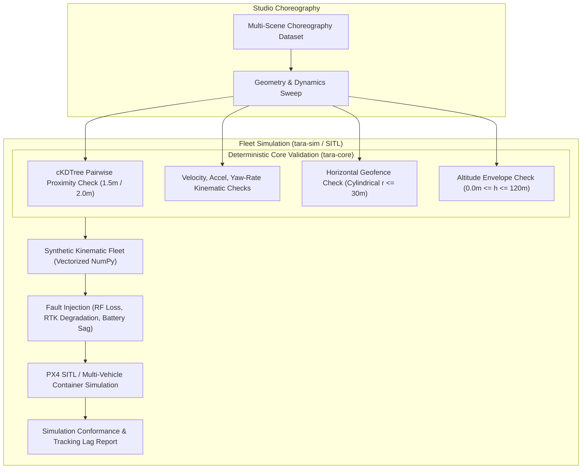
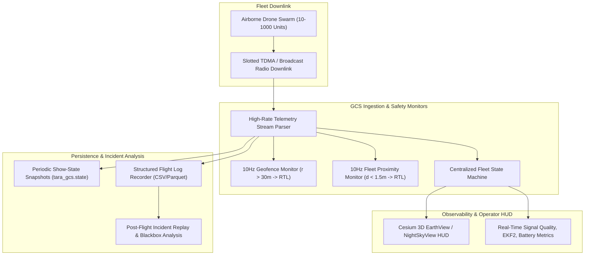

# Taramandal Software Engineering Dependency Graph

**Classification:** Public-Safe Architecture Specification  
**Version:** 1.0.0  
**Scope:** Canonical Software Pipelines (Studio, GCS, Core, Sim)

---

## 1. End-to-End Mission Pipeline

The primary mission compilation, upload, and autonomous execution flow:

```mermaid
graph TD
    subgraph Studio ["Taramandal Studio (Choreography & Design)"]
        UI["Studio Web UI / Scene Sequencer"] --> Forms["Formation Generation & Voxelization"]
        Forms --> Bounds["Formation Bounding & Constraint Check"]
        Bounds --> TrajGen["Trajectory Generation & Pacing"]
        TrajGen --> StudioVal["Studio Safety Validator (tara_core.validate)"]
    end

    subgraph Contract ["Canonical Mission Contract"]
        StudioVal --> Export["Mission Exporter (JSON / .tarm)"]
        Export --> Schema["Versioned Show Schema (tara_core.show)"]
    end

    subgraph Compiler ["Mission Compiler & Staging"]
        Schema --> PreVal["GCS Upload Gate (collision_errors)"]
        PreVal --> OptAssign["Hungarian Pad-to-Target Assignment"]
        OptAssign --> Splitter["Per-Drone Trajectory Decomposer"]
        Splitter --> BinaryPacker["Deterministic Binary Mission Compiler"]
    end

    subgraph GCS ["Taramandal GCS (Fleet Management)"]
        BinaryPacker --> Staging["GCS Fleet Staging & Verification"]
        Staging --> PreArm["Deterministic Pre-Arm Safety Gate"]
        PreArm --> Transport["Authenticated Transport Layer"]
    end

    subgraph Fleet ["Drone Fleet Execution"]
        Transport --> PreUpload["Onboard Flash / Storage Pre-Upload"]
        PreUpload --> HashCheck["Mission Hash / Signature Verification"]
        HashCheck --> SyncTrigger["Synchronized UTC Start Broadcast"]
        SyncTrigger --> AutonomousExec["Autonomous Onboard Trajectory Execution"]
    end
```



---

## 2. Simulation & Design-Time Validation Pipeline

The closed-loop design and verification pipeline before flight staging:



---

## 3. Real-Time Telemetry, Observability & Incident Replay Pipeline

The runtime monitoring, geofence interlock, and incident analysis pipeline:



---

## 4. Subsystem Dependency Hierarchy

```
tara-core  (Pure mathematical, spatial safety, and contract definitions)
   ▲
   ├── tara-studio (Choreography authoring, pacing, voxelization)
   │      ▲
   │      └── tara-studio-web (React 18 / Three.js browser IDE)
   │
   ├── tara-sim (Vectorized kinematics, SITL orchestration, fault models)
   │      ▲
   │      └── tara-gcs (Ground Control Station, fleet FSM, safety interlocks)
   │             ▲
   │             └── tara-web (WebGL NightSkyView, Cesium geospatial HUD)
```
