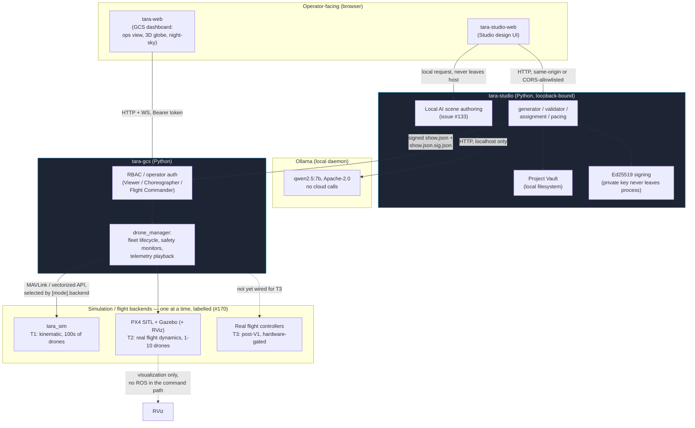

# Yukti / IIC Evidence Pack (issue #134)

Parent: [#122](https://github.com/harsh-pandhe/Taramandal-GCS/issues/122) (V1 Yukti/IIC integrated proof demonstrator).

This is the consolidated index #134 asks for: setup checklist, architecture
diagram, results matrix, and test evidence, in one place for review before
anything here is shared externally. It links out to the existing detailed
docs rather than duplicating them, and is explicit about what is still
missing — **this pack is not yet complete** (see [Status](#status) below).

Every tier label below follows the fidelity convention #170 established:

- **T1 (`tara_sim`)** — kinematic, no flight dynamics. Scales to hundreds of
  drones on one machine.
- **T2 (PX4 SITL + Gazebo, + RViz)** — real flight dynamics, 1–10 drones,
  bounded by what one machine's SITL instances can carry.
- **T3 (hardware)** — post-V1, only if safely approved and actually flown.

## Status

| Deliverable | State |
|---|---|
| Environment setup / run / test / recovery checklist | Done — links existing docs, below |
| Architecture diagram with trust/safety boundaries | Done, this document |
| Results matrix (T1 / T2 / T3) | Partially done — T1 filled, T2 partially filled (single-drone only), T3 not started |
| Test evidence table (SHA, PR, fleet size, timing, separation) | Done for everything flown so far |
| Recordings (Studio full-screen preview, GCS + Gazebo + RViz) | **Not done** — Harsh's hardware/recording pass, see [#171](https://github.com/harsh-pandhe/Taramandal-GCS/issues/171) |
| Hardware BOM, wiring/configuration | **Not done** — owned by the hardware lead, not yet supplied |
| Asset/music provenance and usage rights | **Not done** — blocked on sourcing a licensed track, see [#132](https://github.com/harsh-pandhe/Taramandal-GCS/issues/132) |
| Limitations / next V2 steps | Done, below |
| Reviewed by Harsh before external sharing | **Not done** |

## 1. Environment setup, run, test and recovery checklist

Don't duplicate these — they're kept current as their own docs and are
exercised regularly, most recently while compiling this pack:

- **Clean setup and running the stack**: [README.md](../README.md)
  ("Quickstart"). `./tara doctor` first — it now checks Python/Node
  versions, not just that the binaries exist, and the PX4/Gazebo backend's
  own prerequisites (issue #177).
- **PX4 SITL + Gazebo backend specifically**: [sim/px4/README.md](../sim/px4/README.md)
  — pinned PX4 version, build recipe, known-good Gazebo version, and the
  Node-version crash mode `tara doctor` now catches before it takes the
  whole supervised stack down.
- **Signed show files** (Studio → GCS upload path): README.md,
  "Signed show files" section — `tara keygen` / `tara sign`, and the
  `--allow-unsigned` escape hatch for pre-signing development.
- **Running the full test suite, locally or via the exact CI gates**:
  [docs/local-ci.md](local-ci.md) — `./scripts/ci` runs the same 5 gates as
  the GitHub workflow (lint/typecheck, Python tests, frontend tests, scale
  regression, Playwright E2E/visual baseline), with the same pass/fail
  output either place.
- **Recovery**: the GCS persists its fleet/session state and resumes a
  killed-and-restarted process without losing in-flight show state —
  exercised directly by `packages/tara-gcs/tests/test_show_resume.py`,
  itself re-verified end-to-end as part of this pack's prep (see
  [issue #171's findings comment](https://github.com/harsh-pandhe/Taramandal-GCS/issues/171#issuecomment-6533695510)).

## 2. Architecture

**Trust/safety boundaries**, matching
[docs/security/studio_threat_model.md](security/studio_threat_model.md):

- **Studio binds to loopback by default.** CORS never allows a wildcard
  origin with credentials.
- **The Ed25519 signing private key never leaves the Studio process** —
  only the public key and fingerprint are ever served.
- **The GCS refuses an unsigned trajectory** (403) unless the stack was
  explicitly started with `--allow-unsigned` for local development.
- **Every GCS command endpoint requires an authenticated operator** since
  RBAC landed (#64) — `/api/status` is the one deliberate exception, kept
  unauthenticated for scripted health checks (`tara status`, this pack's
  own readiness probes).
- **RViz is visualization only** — it has no path back into the command
  chain; the GCS never depends on ROS being present or correct.
- **The local AI assistant (#133) is local-only**: Ollama runs on the same
  host, no network egress, and the model's own license (Apache-2.0) and
  digest are pinned in [packages/tara-studio/README.md](../packages/tara-studio/README.md).

## 3. Results matrix

| | T1 (`tara_sim`) | T2 (PX4 SITL + Gazebo) | T3 (hardware) |
|---|---|---|---|
| **Scale demonstrated** | 35 / 100 / 500 / 1000 drones | 1 drone (hover/climb/land cycle) | Not started |
| **What's proven** | Real-time factor ≥0.98 up to 1000 drones, zero late ticks, zero proximity/geofence/altitude violations across all 5 formation generators (circle, helix, heart, cube, spline). Studio-built shows now certify through the real `/api/export` jerk gate (#160, 5 reference shows). A 3-drone Studio-built show runs the whole software chain on the sim backend: signed export, GCS upload and staging, `preview_only` refusal, onboard refused before takeoff, streamed start reaches RUNNING (#172, T1 half). Sim-only fault tools exist for failsafe testing: distance-based + burst RF loss (#62) and RTK / battery / deviation / motor-failure injection (#63) | A full PREFLIGHT→ARM→climb-to-hover→dwell→land→disarm cycle against real PX4 flight-control code and Gazebo physics; the #145 climb-stall fix confirmed against real liftoff-ramp delay (observed 0.86 m vs 1.0 m target, within the `max(0.15, 0.1×target)` tolerance); a concurrent duplicate-hover request cleanly rejected without disturbing the original flight | — |
| **What's outstanding** | — | The T2 half of [#172](https://github.com/harsh-pandhe/Taramandal-GCS/issues/172): a Studio-built show flown against PX4 SITL + Gazebo (its software chain passes on the sim backend only; [#160](https://github.com/harsh-pandhe/Taramandal-GCS/issues/160)'s jerk-pacing fix that gated it has merged); the human-witnessed Gazebo+RViz+GCS-dashboard recording and the remaining fault-matrix cases ([#171](https://github.com/harsh-pandhe/Taramandal-GCS/issues/171), owned by Harsh) | Safety approval, bench test, supervised hover/landing ([#135](https://github.com/harsh-pandhe/Taramandal-GCS/issues/135), explicitly deferred behind #171) |
| **Evidence** | [docs/fleet-scale-benchmark.md](fleet-scale-benchmark.md), [docs/validate-latency-benchmark.md](validate-latency-benchmark.md) | [Findings comment on #171](https://github.com/harsh-pandhe/Taramandal-GCS/issues/171#issuecomment-6533695510) | — |

The 35-drone near-term Dandiya show (NAVRATRI / diya / dandiya sticks /
HAPPY NAVRATRI) is confirmed T1 software/validation evidence per the
[comment on #134 itself](https://github.com/harsh-pandhe/Taramandal-GCS/issues/134#issuecomment-6397359332)
— minimum separation 2.000000 m at the shared launch pads (design limit
exactly, accepted as-is for this demo rather than widening the grid before
it), ≥2.05 m everywhere else. **This is a simulation/software validation
claim (`/api/validate`), not a physical flight claim.**

## 4. Test evidence

| Area | Evidence | SHA / PR | Fleet size | Result |
|---|---|---|---|---|
| Python test suite (all packages) | `pytest` | current `main` | — | 1517 tests collected, full suite (including `slow`-marked) passes |
| `/api/validate` latency | [docs/validate-latency-benchmark.md](validate-latency-benchmark.md) | #164, pinned by #189 (`bedd65f`) | 100 / 500 / 1000 | ~1.7 s / ~8 s / ~21 s via HTTP; near-linear growth, not the old superlinear blow-up |
| `tara_sim` real-time factor | [docs/fleet-scale-benchmark.md](fleet-scale-benchmark.md) | #51 | 100 / 500 / 1000 | xRT 1.00, 0.0% late ticks at every size tested |
| Formation generators, zero-violation | `packages/tara-studio/tests/test_generator_regression.py` | current `main` | 50 / 100 per shape × 5 shapes | 0 proximity / geofence / altitude violations |
| Circle-orbit pacing | `packages/tara-studio/tests/test_issue_88_circle_orbit_pacing.py` | #88, `d06a0fd` | 50 / 75 / 90 / 100 | Full 2π orbit completed (previously ~1/3 turn), 0 dynamics violations |
| Single-drone PX4 SITL + Gazebo hover cycle | [#171 findings comment](https://github.com/harsh-pandhe/Taramandal-GCS/issues/171#issuecomment-6533695510) | #201, `ee60b72` (groundwork); PX4 v1.16.2, Gazebo Sim 8.15 | 1 | 2 clean runs, climb to 0.86 m (target 1.0 m, within tolerance), clean land/disarm; 1 fault-matrix case (concurrent duplicate request) verified rejected |
| PX4 SITL world generation | #177, `fd05c9f` (generator) + `49117d3` (checkout fixes) | — | Confirmed loadable by a real Gazebo Sim 8.15 instance, real PX4 v1.16.2 spawn |
| GCS crash-recovery (kill + restart mid-show) | `packages/tara-gcs/tests/test_show_resume.py::test_kill_and_restart_gcs_process_recovers_state` | #201, `ee60b72` | 1 | Passes against a real spawned GCS process, RBAC-authenticated |
| Studio-web focus/motion accessibility | #132 (partial), #204, `420812d` | — | 54/54 Playwright e2e + visual-baseline tests pass, 0 snapshot diffs |
| Studio-built shows certify the jerk gate | `packages/tara-studio/tests/test_issue_160_jerk_pacing_certification.py` | #160, #179 `f8df46c` | 6 / 24 / 24 / 100 / 100 (5 reference shows) | 0 jerk violations through the real `/api/export`; shows plateau ~14-17 m/s³ against the 20 m/s³ limit; default build rate is now 10 Hz. Reference shows are reconstructions (the issue's exact scene parameters were not preserved) |
| Studio-built show through the GCS, sim backend (T1) | `packages/tara-gcs/tests/test_issue_172_studio_gcs_e2e.py` | #172 (software-chain half), #209 `3ee84a1` | 3 | Certified, Ed25519-signed export verified against GCS `trusted_keys`; upload and staging; `preview_only` refused; onboard refused before takeoff; streamed start reaches RUNNING. **Sim backend only; the PX4 SITL + Gazebo (T2) runs and recordings remain open** |
| RF channel model (sim) | `packages/tara-sim/tests/test_rf_channel.py`, `packages/tara-gcs/tests/test_sim_rf_channel.py` | #62, #206 `9497dde` | — | 100% loss for 5 s trips the offboard-loss failsafe to LAND; 10% loss flickers `connected` without latching; same seed gives a bit-identical sequence. TDMA slot jitter not implemented (split to #207) |
| Sensor / actuator fault injection (sim) | `packages/tara-gcs/tests/test_fault_injection.py`, `packages/tara-sim/tests/test_fleet_state.py` | #63, #208 `8870d4e` | 1 faulted drone per case | RTK loss, battery, 1.5 m position deviation (trips the real proximity monitor) and motor failure (drives the real abort-to-land path) each verified; 33 new tests. `backend=sim` only |
| Studio typography / visual-hierarchy pass | [PR #210](https://github.com/harsh-pandhe/Taramandal-GCS/pull/210) (part of #132) | **open, not merged: no SHA yet** | — | Checked live in a real browser at 1440x900 and 1280x720; 13 visual baselines changed and each is justified in the PR; Docker Playwright 54/54 without `--update`; faint-text contrast raised from 2.9-3.4:1 to 4.6-5.4:1 |

## 5. Hardware BOM, wiring and configuration

**Not supplied yet.** Owned by the hardware lead, not something this pack
can fill in from the software side. Placeholder section — fill in before
this pack is reviewed for external sharing.

## 6. Asset / music provenance and usage rights

**Not supplied yet.** The full-screen preview's music track (#132's scope)
needs a track with clear usage rights for a public/semi-public demo; no
track has been sourced. Placeholder section.

## 7. Limitations, uncompleted items and next V2 steps

- **No real multi-drone flight evidence yet.** Everything T2 so far is a
  single simulated drone. #172's software chain now passes on the sim
  backend (#209), and #160's jerk-pacing fix is merged (#179), so what
  remains is flying a Studio-built show against PX4 SITL + Gazebo, plus
  Harsh's own #171 hardware/recording pass.
- **No real hardware evidence at all** — T3 is entirely future work,
  explicitly post-V1 per #135.
- **No recordings exist yet** for the pack's "Recordings" deliverable
  (Studio full-screen preview; GCS with Gazebo and RViz both visible).
  These require a human at the keyboard with a screen recorder, not
  something to simulate or fabricate.
- **#167** (widen the shared launch-pad grid from 2.0 m to 2.2 m) is
  implemented and merged (`8d5f209`) but kept open pending a maintainer
  decision on whether pre-#167 `.tara` files need a migration/version gate
  — noted here since it touches this pack's pad-spacing finding above.
- **V2 roadmap** (#123): the professional Studio/GCS workflow set — things
  like the full observability/replay tooling in #65, music-aware
  choreography in #91, and the broader AI copilot work in #89/#90/#94 — is
  explicitly out of this pack's scope; V1's evidence capture is
  deliberately the smaller slice #65's own roadmap note describes.

---

🤖 Generated with [Claude Code](https://claude.com/claude-code)
