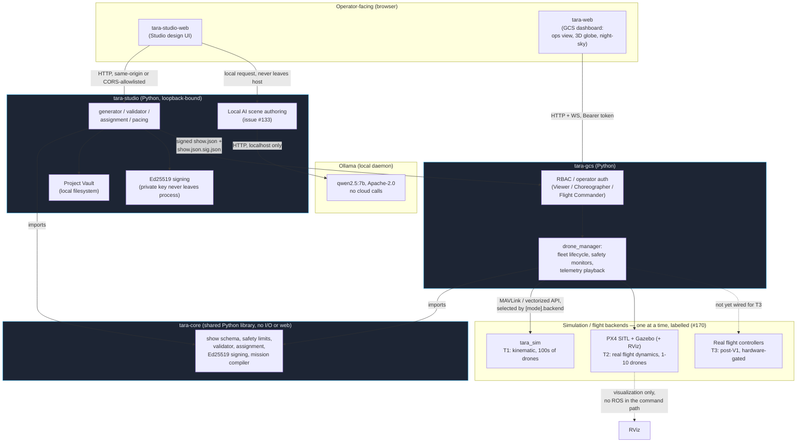

# Yukti / IIC Evidence Pack (issue #134)

Parent: [#122](https://github.com/harsh-pandhe/Taramandal-GCS/issues/122) (V1 Yukti/IIC integrated proof demonstrator).

This is the consolidated index #134 asks for: setup checklist, architecture
diagram, results matrix, and test evidence, in one place for review before
anything here is shared externally. It links out to the existing detailed
docs rather than duplicating them, and is explicit about what is still
missing — **this pack is not yet complete** (see [Status](#status) below).

Every tier label below follows the fidelity convention #170 established:

- **T1 (`tara_sim`)** — kinematic, no flight dynamics. Scales to hundreds of
  drones on one machine.
- **T2 (PX4 SITL + Gazebo, + RViz)** — real flight dynamics, 1–10 drones,
  bounded by what one machine's SITL instances can carry.
- **T3 (hardware)** — post-V1, only if safely approved and actually flown.

## Status

| Deliverable | State |
|---|---|
| Environment setup / run / test / recovery checklist | Done — links existing docs, below |
| Architecture diagram with trust/safety boundaries | Done, this document |
| Results matrix (T1 / T2 / T3) | Partially done — T1 filled, T2 partially filled (single-drone hover; the Diwali segment at 3 / 5 / 8 drones; #171 and #172 acceptance DONE on tree `335d84d` (decided by Dhiraj on 2026-11-16 while Harsh was unavailable; see the T2 recorded-acceptance row in section 4 and [section 9](#9-134-acceptance-audit)); local, non-stock-build T2 clips exist, see the Recordings row), T3 not started |
| Test evidence table (SHA, PR, fleet size, timing, separation) | Done for everything flown so far |
| Repeatable evidence checklist (commands that reproduce each result) | Done, [section 8](#8-repeatable-evidence-checklist); the human-gated items are listed there as blocked, not faked |
| Recordings (Studio full-screen preview, GCS + Gazebo + RViz) | **Partially done** — the only recording is an automated Studio UI tour, `docs/recordings/taramandal-studio-walkthrough.mp4` (made by `tools/record/record_studio_walkthrough.mjs`, #132). It does not include the full-screen preview or an export, and the script answers the validate, energy, signing and chain-assignment calls with canned responses. `tools/record/record_desktop_gazebo.sh` has still not been run ([#171](https://github.com/harsh-pandhe/Taramandal-GCS/issues/171), [#172](https://github.com/harsh-pandhe/Taramandal-GCS/issues/172)). Three GCS dashboard + Gazebo + RViz clips (T2, simulation, 1, 3 and 10 drones) were recorded with ffmpeg screen capture instead and are in `docs/recordings/`: [1 drone](recordings/diwali2026_T2_1drone_px4-sitl-gazebo-rviz-gcs-dashboard_20261105_d7e7b2e-localbuild-redacted.mp4), [3 drones](recordings/diwali2026_T2_3drones_px4-sitl-gazebo-rviz-gcs-dashboard_20261105_d7e7b2e-localbuild-redacted.mp4), [10 drones](recordings/diwali2026_T2_10drones_3d-formations_px4-sitl-gazebo-rviz-gcs-dashboard_20261105_d7e7b2e-localbuild-redacted.mp4), each with a `.notes.json` beside it. What they are not: they are **local, non-stock builds on `d7e7b2e`** (locally patched native PX4 v1.16.2, Gazebo Sim 8.10 where the container image has 8.15, trimmed Gazebo and RViz layouts, streamed execution); the **10-drone clip shows 3 custom formations that Studio cannot author today**; no clip includes landing, the Studio preview, hardware or a Gazebo ground-truth comparison. They were redacted (the RViz title bar showed a local path and username) and the check covered every title bar and 6 s contact sheets, **not every frame by eye**. The unredacted originals are not in the repo. Two more clips, a single-drone hover take and a 3-drone Studio show take on tree `335d84d` (`docs/recordings/t2_*`, each with a `.notes.json`), were added with the recorded acceptance: the redaction was checked mechanically on every frame (1036 and 4246) and by 1 fps contact sheets, and they carry an on-screen label bar with the tier, drone count and commit tree; they are the same local, non-stock build (Gazebo 8.10). The T2 acceptance of #171 and #172 was decided by Dhiraj on 2026-11-16 (section 9), not by these clips alone. Human steps: [recording-checklist.md](recording-checklist.md) |
| Hardware BOM, wiring/configuration | **Not done** — owned by the hardware lead, not yet supplied |
| Asset/music provenance and usage rights | **Not done** — blocked on sourcing a licensed track, see [#132](https://github.com/harsh-pandhe/Taramandal-GCS/issues/132) |
| Limitations / next V2 steps | Done, below |
| Reviewed by Harsh before external sharing | **Not done** |
| Audit of this pack against #134's acceptance criteria | Done 2026-11-04 on `d7e7b2e`, [section 9](#9-134-acceptance-audit) |

## 1. Environment setup, run, test and recovery checklist

Don't duplicate these — they're kept current as their own docs and are
exercised regularly, most recently while compiling this pack:

- **Clean setup and running the stack**: [README.md](../README.md)
  ("Quickstart"). `./tara doctor` first — it now checks Python/Node
  versions, not just that the binaries exist, and the PX4/Gazebo backend's
  own prerequisites (issue #177).
- **PX4 SITL + Gazebo backend specifically**: [sim/px4/README.md](../sim/px4/README.md)
  — pinned PX4 version, build recipe, known-good Gazebo version, and the
  Node-version crash mode `tara doctor` now catches before it takes the
  whole supervised stack down.
- **Signed show files** (Studio → GCS upload path): README.md,
  "Signed show files" section — `tara keygen` / `tara sign`, and the
  `--allow-unsigned` escape hatch for pre-signing development.
- **Running the full test suite, locally or via the exact CI gates**:
  [docs/local-ci.md](local-ci.md) — `./scripts/ci` runs the same 5 gates as
  the GitHub workflow (lint/typecheck, Python tests, frontend tests, scale
  regression, Playwright E2E/visual baseline), with the same pass/fail
  output either place.
- **Recovery**: the GCS persists its fleet/session state and resumes a
  killed-and-restarted process without losing in-flight show state —
  exercised directly by `packages/tara-gcs/tests/test_show_resume.py`,
  itself re-verified end-to-end as part of this pack's prep (see
  [issue #171's findings comment](https://github.com/harsh-pandhe/Taramandal-GCS/issues/171#issuecomment-6533695510)).

## 2. Architecture

`tara-core` holds what Studio and the GCS must agree on: the show schema, the safety limits (one definition, `DEFAULT_LIMITS`), the validator, assignment, signing
and the mission compiler. It does no I/O and imports no web framework or autopilot library.

**Trust/safety boundaries**, matching
[docs/security/studio_threat_model.md](security/studio_threat_model.md):

- **Studio binds to loopback by default.** CORS never allows a wildcard
  origin with credentials.
- **The Ed25519 signing private key never leaves the Studio process** —
  only the public key and fingerprint are ever served.
- **The GCS refuses an unsigned trajectory** (403) unless the stack was
  explicitly started with `--allow-unsigned` for local development.
- **Every GCS command endpoint requires an authenticated operator** since
  RBAC landed (#64) — `/api/status` is the one deliberate exception, kept
  unauthenticated for scripted health checks (`tara status`, this pack's
  own readiness probes).
- **RViz is visualization only** — it has no path back into the command
  chain; the GCS never depends on ROS being present or correct.
- **The local AI assistant (#133) is local-only**: Ollama runs on the same
  host, no network egress, and the model's own license (Apache-2.0) and
  digest (`qwen2.5:7b`, `sha256:845dbda0ea48…`, read from a local Ollama and
  matched against the registry on 2026-11-02) are recorded in
  [packages/tara-studio/README.md](../packages/tara-studio/README.md). The
  digest is documentation only; Studio does not check it at runtime.

## 3. Results matrix

| | T1 (`tara_sim`) | T2 (PX4 SITL + Gazebo) | T3 (hardware) |
|---|---|---|---|
| **Scale demonstrated** | 35 / 100 / 500 / 1000 drones | 1 drone (hover/climb/land cycle); 3 / 5 / 8 drones flying the real Diwali segment (#222, #220) | Not started |
| **What's proven** | Real-time factor ≥0.98 up to 1000 drones, zero late ticks, zero proximity/geofence/altitude violations across all 5 formation generators (circle, helix, heart, cube, spline). Studio-built shows now certify through the real `/api/export` jerk gate (#160, 5 reference shows). A 3-drone Studio-built show runs the whole software chain on the sim backend: signed export, GCS upload and staging, `preview_only` refusal, onboard refused before takeoff, streamed start reaches RUNNING (#172, T1 half). Sim-only fault tools exist for failsafe testing: distance-based + burst RF loss (#62) and RTK / battery / deviation / motor-failure injection (#63) | A full PREFLIGHT→ARM→climb-to-hover→dwell→land→disarm cycle against real PX4 flight-control code and Gazebo physics; the #145 climb-stall fix confirmed against real liftoff-ramp delay (observed 0.86 m vs 1.0 m target, within the `max(0.15, 0.1×target)` tolerance); a concurrent duplicate-hover request cleanly rejected without disturbing the original flight; pilot takeover mid-hover yielded to rather than fought (#211). A Studio-built show, the real Diwali 3-drone segment, flown through the GCS (signed, streamed start): 3 of 3 baseline runs pass, plus one run each at 5 and 8 drones (#222), and after the start-leg fix (#220) 3 of 3 pass with the start transient down from up to 3.7 s to 0.01 s and max tracking error from about 5.9 m to about 0.3 m | — |
| **What's outstanding** | — | **Acceptance evidence is complete on one tree** (`335d84d`): see the T2 recorded-acceptance row in section 4 and `docs/sitl-t2-recorded-acceptance/`. Still outstanding for T2: a PX4-denied `land` while airborne, a fault where the link is up but one telemetry field freezes, the intermittent 1-in-4 failure at 5 drones ([#254](https://github.com/harsh-pandhe/Taramandal-GCS/pull/254)), a stretch run at about 10 drones on the current tree, and the hover started from a dashboard control instead of an API call | Safety approval, bench test, supervised hover/landing ([#135](https://github.com/harsh-pandhe/Taramandal-GCS/issues/135), explicitly deferred behind #171) |
| **Evidence** | [docs/fleet-scale-benchmark.md](fleet-scale-benchmark.md), [docs/validate-latency-benchmark.md](validate-latency-benchmark.md) | [Findings comment on #171](https://github.com/harsh-pandhe/Taramandal-GCS/issues/171#issuecomment-6533695510) | — |

The 35-drone near-term Dandiya show (NAVRATRI / diya / dandiya sticks /
HAPPY NAVRATRI) is confirmed T1 software/validation evidence per the
[comment on #134 itself](https://github.com/harsh-pandhe/Taramandal-GCS/issues/134#issuecomment-6397359332)
— minimum separation 2.000000 m at the shared launch pads (design limit
exactly, accepted as-is for this demo rather than widening the grid before
it), ≥2.05 m everywhere else. **This is a simulation/software validation
claim (`/api/validate`), not a physical flight claim.**

### Software tests (unit and integration), kept apart from simulation evidence

None of these is T1, T2 or T3 evidence: they show that the software behaves as specified when a vehicle is faked or absent. Measured on `main` at
`df6b64e` on 2026-11-17 (CI for that commit: [7 of 7 checks green](https://github.com/harsh-pandhe/Taramandal-GCS/commit/df6b64e/checks)).

| Suite | What it is | Count | Tier |
|---|---|---|---|
| Python: `tara-core`, `tara-gcs`, `tara-sim`, `tara-studio`, `tools` (`pytest -p asyncio -m "not slow"`) | unit and in-process integration tests; where a vehicle is needed they use the `tara_sim` or a mocked one, never PX4 or Gazebo | **2,702 passed**, 7 `slow` tests deselected (the 100-drone show runs in CI's scale-regression job). 1 failed: `test_server_dies_with_the_gcs[SIGHUP]`, **only because my run was launched under `nohup`**, which makes children inherit an ignored SIGHUP; it passes in an ordinary shell and CI does not fail it (made hermetic in #306) | n/a: software tests (T1 where a test drives `tara_sim`) |
| Studio web (`vitest`) | engine, hooks and components of `tara-studio-web` | **1,165 passed** in 64 files | n/a: software tests |
| Playwright, `tara-web` | dashboard end to end against a stubbed backend and a mocked telemetry socket | 85 tests in 11 files (listed, not run here; CI runs them and was green) | n/a: UI tests |
| Playwright, `tara-studio-web` | Studio end to end and the visual baselines (pinned Docker image) | 84 tests in 1 file (listed, not run here; CI runs them and was green) | n/a: UI tests |

The older `1881 passed` figure in the first row of the table below is for `d7e7b2e` and was not re-run when it was written; the numbers above supersede it.

## 4. Test evidence

| Area | Evidence | SHA / PR | Fleet size | Result |
|---|---|---|---|---|
| Python test suite (all packages) (n/a: software test) | `pytest` (full run, including `slow`-marked) | `d7e7b2e` ([CI](https://github.com/harsh-pandhe/Taramandal-GCS/commit/d7e7b2eb25af2f3e46db9156719089909e978f5a/checks)) | — | 1881 passed. Run by Dhiraj on `d7e7b2e`; **not re-run when this row was written**. A first run showed one failure that came from starting the suite under `nohup` (which ignores SIGHUP), not from the code; started normally it passes (per the run's author) |
| `/api/validate` latency (n/a: software benchmark) | [docs/validate-latency-benchmark.md](validate-latency-benchmark.md) | #164, pinned by #189 (`bedd65f` ([CI](https://github.com/harsh-pandhe/Taramandal-GCS/commit/bedd65f65f9150405cb2d95c7178cbb02164c78a/checks))) | 100 / 500 / 1000 | ~1.7 s / ~8 s / ~21 s via HTTP; near-linear growth, not the old superlinear blow-up |
| `tara_sim` real-time factor (T1) | [docs/fleet-scale-benchmark.md](fleet-scale-benchmark.md) | #51 | 100 / 500 / 1000 | xRT 1.00, 0.0% late ticks at every size tested |
| Formation generators, zero-violation (n/a: software test) | `packages/tara-studio/tests/test_generator_regression.py` | current `main` | 50 / 100 per shape × 5 shapes | 0 proximity / geofence / altitude violations |
| Circle-orbit pacing (n/a: software test) | `packages/tara-studio/tests/test_issue_88_circle_orbit_pacing.py` | #88, `d06a0fd` ([CI](https://github.com/harsh-pandhe/Taramandal-GCS/commit/d06a0fd8fd10fc0f6cbce52e9942514b684554e6/checks)) | 50 / 75 / 90 / 100 | Full 2π orbit completed (previously ~1/3 turn), 0 dynamics violations |
| Single-drone PX4 SITL + Gazebo hover cycle (T2) | [#171 findings comment](https://github.com/harsh-pandhe/Taramandal-GCS/issues/171#issuecomment-6533695510) | #201, `ee60b72` ([CI](https://github.com/harsh-pandhe/Taramandal-GCS/commit/ee60b72fe7a7f79b23c8de8e0a45ff37abb7791a/checks)) (groundwork); PX4 v1.16.2, Gazebo Sim 8.15 | 1 | 2 clean runs, climb to 0.86 m (target 1.0 m, within tolerance), clean land/disarm; 1 fault-matrix case (concurrent duplicate request) verified rejected |
| PX4 SITL world generation (T2) | #177, `fd05c9f` (generator) + `49117d3` (checkout fixes) | — | Confirmed loadable by a real Gazebo Sim 8.15 instance, real PX4 v1.16.2 spawn |
| GCS crash-recovery (kill + restart mid-show) (T1) | `packages/tara-gcs/tests/test_show_resume.py::test_kill_and_restart_gcs_process_recovers_state` | #201, `ee60b72` ([CI](https://github.com/harsh-pandhe/Taramandal-GCS/commit/ee60b72fe7a7f79b23c8de8e0a45ff37abb7791a/checks)) | 1 | Passes against a real spawned GCS process, RBAC-authenticated |
| Studio-web focus/motion accessibility (n/a: UI test) | #132 (partial), #204, `420812d` | — | 54/54 Playwright e2e + visual-baseline tests pass, 0 snapshot diffs |
| Studio-built shows certify the jerk gate (n/a: software check) | `packages/tara-studio/tests/test_issue_160_jerk_pacing_certification.py` | #160, #179 `f8df46c` ([CI](https://github.com/harsh-pandhe/Taramandal-GCS/commit/f8df46c07294c02fddb8d09f36463c610636cb9b/checks)) | 6 / 24 / 24 / 100 / 100 (5 reference shows) | 0 jerk violations through the real `/api/export`; shows plateau ~14-17 m/s³ against the 20 m/s³ limit; default build rate is now 10 Hz. Reference shows are reconstructions (the issue's exact scene parameters were not preserved) |
| Studio-built show through the GCS, sim backend (T1) | `packages/tara-gcs/tests/test_issue_172_studio_gcs_e2e.py` | #172 (software-chain half), #209 `3ee84a1` ([CI](https://github.com/harsh-pandhe/Taramandal-GCS/commit/3ee84a1b89ab724eae6d305c7bbb314ce713d267/checks)) | 3 | Certified, Ed25519-signed export verified against GCS `trusted_keys`; upload and staging; `preview_only` refused; onboard refused before takeoff; streamed start reaches RUNNING. **Sim backend only; the PX4 SITL + Gazebo (T2) runs and recordings remain open** |
| RF channel model (sim) (T1) | `packages/tara-sim/tests/test_rf_channel.py`, `packages/tara-gcs/tests/test_sim_rf_channel.py` | #62, #206 `9497dde` ([CI](https://github.com/harsh-pandhe/Taramandal-GCS/commit/9497ddec4d99c25270c4f67d523fff98cb8aeef7/checks)) | — | 100% loss for 5 s trips the offboard-loss failsafe to LAND; 10% loss flickers `connected` without latching; same seed gives a bit-identical sequence. TDMA slot jitter not implemented (split to #207) |
| Sensor / actuator fault injection (sim) (T1) | `packages/tara-gcs/tests/test_fault_injection.py`, `packages/tara-sim/tests/test_fleet_state.py` | #63, #208 `8870d4e` ([CI](https://github.com/harsh-pandhe/Taramandal-GCS/commit/8870d4e82724679ed6e9f45ce71ca2a95bb4de88/checks)) | 1 faulted drone per case | RTK loss, battery, 1.5 m position deviation (trips the real proximity monitor) and motor failure (drives the real abort-to-land path) each verified; 33 new tests. `backend=sim` only |
| Studio typography / visual-hierarchy pass (n/a: UI test) | [PR #210](https://github.com/harsh-pandhe/Taramandal-GCS/pull/210) (part of #132) | #210 `b263a54` ([CI](https://github.com/harsh-pandhe/Taramandal-GCS/commit/b263a54fe5a19be06b7270c1a032f48496dafd2a/checks)) | — | Checked live in a real browser at 1440x900 and 1280x720; 13 visual baselines changed and each is justified in the PR; Docker Playwright 54/54 without `--update`; faint-text contrast raised from 2.9-3.4:1 to 4.6-5.4:1 |
| Pilot takeover & armed telemetry freshness (T2) | [PR #211](https://github.com/harsh-pandhe/Taramandal-GCS/pull/211) (part of #171) | #211 `1ac5de5` ([CI](https://github.com/harsh-pandhe/Taramandal-GCS/commit/1ac5de5a43b13085c652de73703f06b6d87f7355/checks)) | 1 | Real PX4 SITL + Gazebo: GCS yields cleanly when pilot takes over mid-sequence (`OperatorTakeoverError`), preventing fighting flight commands; armed count in `/api/status` is heartbeat-fresh |
| Gazebo SITL spawn axis & pad alignment (T2) | [PR #215](https://github.com/harsh-pandhe/Taramandal-GCS/pull/215) (part of #172, F1) | #215 `2ae5b44` ([CI](https://github.com/harsh-pandhe/Taramandal-GCS/commit/2ae5b442cc4b20e67829f0b88a51fa3ce6040d2f/checks)) | 3 | Aligned Gazebo ENU world pads and spawn coordinates to GCS NED fleet frame (east axis); automatic reinstallation of world in `launch_fleet.sh`; 3 real SITL passes (2.00-2.04 m separation vs 2.05 m plan) |
| Planned vs actual Gazebo flight evaluation (T2) | [PR #213](https://github.com/harsh-pandhe/Taramandal-GCS/pull/213) (part of #172) | #213 `83d040d` ([CI](https://github.com/harsh-pandhe/Taramandal-GCS/commit/83d040d27ef16e09545c47cd149d86f4c45d3033/checks)) | 3 (stretch to 10) | `tools/sitl_planned_vs_actual.py` tracking error evaluation tool and 11 SITL run records; clean flight up to 8 drones |
| Certified Diwali 2026 shows & scale runner (T1) | [PR #212](https://github.com/harsh-pandhe/Taramandal-GCS/pull/212) (part of #122) | #212 `8a243e9` ([CI](https://github.com/harsh-pandhe/Taramandal-GCS/commit/8a243e95f9472c9784fe2224ec368565b63038f9/checks)) | 3 / 35 / 100 / 500 | Storyboards and certified shows (0 violations); minimum separation >= 2.04 m across all fleet sizes; deterministic builds |
| High-rate incident recorder & crash resilience (T1) | [PR #214](https://github.com/harsh-pandhe/Taramandal-GCS/pull/214) (part of #65, V1) | #214 `bef8b7d` ([CI](https://github.com/harsh-pandhe/Taramandal-GCS/commit/bef8b7d20efa5a3929f41108d1e371b19c16d140/checks)) | 100 | `tara_gcs/blackbox.py` 10 Hz compressed JSONL log with differential quantization; 15 min 100 drones = 3.11 MB (< 25 MB budget); survives process kill |
| Show-scale real-time factor profiling (T1) | [PR #216](https://github.com/harsh-pandhe/Taramandal-GCS/pull/216) (part of #122) | #216 `92e99c6` ([CI](https://github.com/harsh-pandhe/Taramandal-GCS/commit/92e99c663b68b96b0515f86b2e67fe4b16959d51/checks)) | 35 / 100 / 500 | `tools/profile_show_rtf.py` and `docs/sim-rtf-profiling.md`; isolated state snapshot serialization cost (~32 of 34 s lost at 500 drones) |
| Mission-upload directory failure is loud (T2) | `packages/tara-gcs/tests/test_mission_upload_directory.py`; [PR #219](https://github.com/harsh-pandhe/Taramandal-GCS/pull/219) (part of #172, F2; builds on #217 `1d45275`) | #219 `2402008` ([CI](https://github.com/harsh-pandhe/Taramandal-GCS/commit/24020080b6c15fcfcc1f22e1f298fec49d1f62bf/checks)) | 3 | An uncreatable mission directory fails that drone's mission with the directory and the last error named, the other drone stays VERIFIED; existing directories unaffected. Real SITL, fresh container each run, no manual `mkdir`: all 3 drones took the mission in 6 runs; with `rootfs/0/fs` made a regular file the mission is FAILED and the launch gate stays closed. Simulated FTP gains `list_directory` |
| Streamed-start transition leg (T2) | `packages/tara-gcs/tests/test_start_bridge.py`, `test_streamed_start_transition.py`; [PR #220](https://github.com/harsh-pandhe/Taramandal-GCS/pull/220) and its [#172 comment](https://github.com/harsh-pandhe/Taramandal-GCS/issues/172#issuecomment-6576644381) (part of #172, F3) | #220 `0d20190` ([CI](https://github.com/harsh-pandhe/Taramandal-GCS/commit/0d201902987daaa58c2cb077bbe2b68b73802b4c/checks)) | 3 | Real Diwali 3-drone segment, 3 SITL runs: start transient 3.5-3.7 s → 0.01 s, max tracking error ~5.9 m → 0.286-0.306 m, Gazebo min separation 2.096-2.181 m (Studio plan 2.20), all PASS, no aborts. The leg is checked exactly against the 1.5 m monitor limit and an unsafe start is refused (400, stays in FORMATION_HOLD). Suite 1698 passed incl. slow. **`execution="onboard"` is untouched.** **The acceptance rerun on `main` after this merge is not recorded in this pack** |
| Baseline Diwali-segment acceptance, before #220 (T2) | [PR #222](https://github.com/harsh-pandhe/Taramandal-GCS/pull/222) (part of #172); `docs/sitl-planned-vs-actual.md` section D | #222 `aca621b` ([CI](https://github.com/harsh-pandhe/Taramandal-GCS/commit/aca621bc4ef3e3627e39b5e7e4522e90e5d3d8a6/checks)), flown on `7a6ab70` | 3 / 5 / 8 | 5 of 5 runs PASS (3 drones ×3, 5 ×1, 8 ×1): Gazebo min separation 2.106-2.169 m, RTF 0.913-1.000, no abort/RTL, worst landing error ≤ 0.083 m. **These runs include the start dive** (#220 was not merged), so they are the "before" for #220, not the final acceptance |
| Flight-mode hint on a failed arming gate (T2) | `packages/tara-gcs/tests/test_preflight_armable_detail.py`; [PR #223](https://github.com/harsh-pandhe/Taramandal-GCS/pull/223) (part of #171) | #223 `ba7f1af` ([CI](https://github.com/harsh-pandhe/Taramandal-GCS/commit/ba7f1af44e522653314d5e6978fb42a8c9745169/checks)) | 1 | PX4 left in LAND/POSCTL read `Not armable` under "EKF health & home lock"; the detail now names the mode as a possible cause. Gate stays red, pass/fail logic unchanged. 4 new cases fail on the old code; full suite 1622 passed, 2 skipped. **Not re-flown on SITL** (text change in a pure function) |
| Single-drone hover with a loaded but unstarted show (T2) | `packages/tara-gcs/tests/test_hover_with_loaded_trajectory.py`; [PR #224](https://github.com/harsh-pandhe/Taramandal-GCS/pull/224) (part of #171) | #224 `9e6d2d4` ([CI](https://github.com/harsh-pandhe/Taramandal-GCS/commit/9e6d2d47019d2fe543d57e8196eb33828681f4c7/checks)) | sim backend | The hover ran after any upload only until a GCS restart; now refused only unless every drone is confirmed parked (not armed, ON_GROUND from fresh telemetry), and the 409 names the drone and reason. 11 cases, 9 fail on the old code; full suite 1623 passed, 2 skipped. **Not re-flown on SITL at merge time.** Known sim-only side effect: a parked sim drone reads IN_AIR in ~0.6% of samples, so a hover is occasionally refused and a retry works (fails closed) |
| Diwali demo-day runbook and helpers (n/a: documentation) | [docs/diwali-runbook.md](diwali-runbook.md); [PR #225](https://github.com/harsh-pandhe/Taramandal-GCS/pull/225) (part of #122) | #225 `bab839b` ([CI](https://github.com/harsh-pandhe/Taramandal-GCS/commit/bab839b62b17539741d7173b144bd9724d55d4b5/checks)), commands run on `7a6ab70` | 3 / 35 / 100 / 500 | Docs and `tools/diwali_*` only. Anything not run is marked NOT VERIFIED in the runbook: the T2 helper `diwali_t2_sitl.sh` end to end, frame rate on a real GPU, any Gazebo/RViz window, T3. Finding: 100 drones cannot go through the GCS upload (5 MB / 100,000-row limit), so the 100-drone run uses `diwali_sim_scale.py` |
| Black-box recorder wired into the GCS (T1) | `packages/tara-gcs/tests/test_blackbox_wiring.py`; [PR #221](https://github.com/harsh-pandhe/Taramandal-GCS/pull/221) (part of #65; does not close it, the replay UI is out of scope) | #221 `b435358` ([CI](https://github.com/harsh-pandhe/Taramandal-GCS/commit/b435358ad7a19ff85c8727b012ed2b22764893b7/checks)) | 100 (tick-cost test) | Default-on 10 Hz recording with commands, lifecycle transitions and breach flags pushed as they happen; 12 new tests including a real GCS startup/shutdown over HTTP. Measured with 100 drones running: no measurable change in event-loop lateness (0.85 → 0.75 ms), service poll mean 0.26 ms, p99 1.7 ms. Suite 1626 passed incl. slow |
| Shared export-gate predicate for the header badge and Transmit tab (n/a: software test) | `packages/tara-studio-web/src/engine/exportGate.test.js`, `SequencerHeader.test.jsx`; [PR #226](https://github.com/harsh-pandhe/Taramandal-GCS/pull/226) (part of #132, follow-up to #210) | #226 `60648b1` ([CI](https://github.com/harsh-pandhe/Taramandal-GCS/commit/60648b1695c40752a4c439d4b731ddb30cadedd8/checks)) | — | The header badge and the Transmit buttons now use one `exportGate()`; a parity test fails if the badge says "exports enabled" while the JSON button is disabled (mutation-checked against the old rule: fails on exactly the three states from review). Checked live in Chromium at 1440×900: 4 states, badge and buttons agreed each time. 10 visual baselines changed, each measured. **"PASSED with no show built" is unit/parity-tested only; it cannot be reached in the live UI** |
| Figures-only Diwali fallback storyboards (T1) | `examples/diwali/storyboard_35_figures.json`, `storyboard_100_figures.json`; [PR #227](https://github.com/harsh-pandhe/Taramandal-GCS/pull/227) (part of #122) | #227 `b780f89` ([CI](https://github.com/harsh-pandhe/Taramandal-GCS/commit/b780f89e371c5ca572499432d658d4c5309e2572/checks)) | 35 / 100 | Flight exports certified through `/api/export` with 0 violations across all categories (separation ≥ 2.05 m, ceiling 34.4 m / 62.8 m); flown in `tara_sim` with min separation 2.045 m and no proximity/geofence breach. Figures: diya, rangoli, sphere burst, diya finale |
| Stop-mid-rotation blackbox regression test (n/a: software test) | `packages/tara-gcs/tests/test_blackbox_wiring.py`, `test_blackbox.py`; [PR #229](https://github.com/harsh-pandhe/Taramandal-GCS/pull/229) (part of #65) | #229 `f9c6240` ([CI](https://github.com/harsh-pandhe/Taramandal-GCS/commit/f9c6240e39ed8c709c2a9e49cfbe92cfa7d4eeac/checks)) | 100 | Regression test `test_stop_cancelling_the_sampler_mid_rotation_still_finishes_the_old_file`: confirms canceling the sampler task during an in-flight rotation completes file close with valid gzip trailer (not truncated); 20 consecutive test runs passed under 16-core CPU load |
| Diwali runbook review fixes & abort procedures (n/a: documentation) | `docs/diwali-runbook.md`, `tools/diwali_t2_sitl.sh`; [PR #230](https://github.com/harsh-pandhe/Taramandal-GCS/pull/230) (part of #122) | #230 `59950b0` ([CI](https://github.com/harsh-pandhe/Taramandal-GCS/commit/59950b0d2941863eff3ebad264d61ede6876ed93/checks)) | — | Clarified real-drone abort procedures, hardware RC kill switch requirements, and updated SITL benchmark numbers after #220 |
| MAVSDK server GCS death lifeline (T2) | `packages/tara-gcs/tara_gcs/mavsdk_lifeline.py`, `tests/test_gcs_death_stops_mavsdk_server.py`; [PR #231](https://github.com/harsh-pandhe/Taramandal-GCS/pull/231) (part of #171, F1) | #231 `70da7b7` ([CI](https://github.com/harsh-pandhe/Taramandal-GCS/commit/70da7b73fec74e506f6a43c4791721b9a34059cf/checks)) | 1 | Bound `mavsdk_server` to GCS process via Linux `PR_SET_PDEATHSIG` (SIGTERM/SIGKILL); ungraceful GCS crash terminates `mavsdk_server` within 0.1s, stopping offboard setpoints and tripping PX4 offboard loss failsafe |
| Telemetry stream auto-restart & staleness (T2) | `packages/tara-gcs/tara_gcs/drone_manager.py`, `tests/test_telemetry_monitor_restart.py`; [PR #232](https://github.com/harsh-pandhe/Taramandal-GCS/pull/232) (part of #171, F2) | #232 `713f705` ([CI](https://github.com/harsh-pandhe/Taramandal-GCS/commit/713f70543c2751c3a6c912de8769afc1b91e52a0/checks)) | 1 | Auto-restart dropped MAVSDK telemetry streams with exponential backoff; mark drone telemetry stale immediately when silent to prevent flying on outdated fixes |
| Takeover during landing & armed-silent detection (T2) | `packages/tara-gcs/tara_gcs/drone_manager.py`, `packages/tara-web/src/`; [PR #233](https://github.com/harsh-pandhe/Taramandal-GCS/pull/233) (part of #171) | #233 `7cf9981` ([CI](https://github.com/harsh-pandhe/Taramandal-GCS/commit/7cf9981018361d4e418ecfbea5c5a67c9b790735/checks)) | 1 | GCS yields cleanly to RC stick takeover during landing wait state (`OperatorTakeoverError`); surfaces armed-but-silent drones prominently on the web dashboard |
| Core raster image-to-formation converter (n/a: software test) | `packages/tara-studio/tara_studio/raster_formation.py`, `tests/test_raster_formation.py`; [PR #234](https://github.com/harsh-pandhe/Taramandal-GCS/pull/234) (part of #90) | #234 `6b4c0ef` ([CI](https://github.com/harsh-pandhe/Taramandal-GCS/commit/6b4c0ef18390c94ef251cef13f473895039a41a4/checks)) | — | Converts PNG/JPEG/WEBP images into drone formations via edge detection, luminosity sampling, and Floyd-Steinberg dithering with collision constraint enforcement (39 tests) |
| Core music audio analysis engine (n/a: software test) | `packages/tara-studio/tara_studio/music_analysis.py`, `tests/test_music_analysis.py`; [PR #235](https://github.com/harsh-pandhe/Taramandal-GCS/pull/235) (part of #91) | #235 `9c10126` ([CI](https://github.com/harsh-pandhe/Taramandal-GCS/commit/9c1012679910f50085888bdf98f5c59bf2a9a671/checks)) | — | Audio analysis engine computing BPM, beat tracking, spectral onsets, musical bars, and keyframe snap grids for choreography alignment (55 tests) |
| Post-F3 SITL planned-vs-actual acceptance runs (T2) | `docs/sitl-planned-vs-actual.md`, `docs/sitl-planned-vs-actual/postf3-*.json`; [PR #236](https://github.com/harsh-pandhe/Taramandal-GCS/pull/236) (part of #172) | #236 `01d178a` ([CI](https://github.com/harsh-pandhe/Taramandal-GCS/commit/01d178ad192a8c6a09d20626348029a3ba3f578c/checks)) | 3 / 5 / 8 | Flown on real PX4 SITL + Gazebo with #220 start bridge: start dive transient eliminated (3.7s → 0.01s), max tracking error < 0.306m (vs 5.9m dive), min separation ≥ 2.096m, 5/5 runs PASS by the tool's own rule (its source, `docs/sitl-planned-vs-actual.md`, qualifies the 5-drone run as degraded in real-time factor and leaves acceptance to a decision; 5 drones were later re-run, see the f556537 row and the T2 repeats row) |
| 35-drone Diwali figures-only show revision (T1) | `examples/diwali/storyboard_35_figures.json`, `results/certify_35_figures.json`; [PR #237](https://github.com/harsh-pandhe/Taramandal-GCS/pull/237) (part of #122) | #237 `eb8ae2c` ([CI](https://github.com/harsh-pandhe/Taramandal-GCS/commit/eb8ae2c33ef868cf9a1c91fad32e4d5564841fee/checks)) | 35 | Replaced rangoli scatter with diya, sphere burst, diya finale (198s duration, 2.05m min sep, 34.1m peak alt, 0 violations); T1 re-flight verified 2.046m min sep |
| Evidence pack audit & recording checklist (n/a: documentation) | `docs/evidence-pack.md`, `docs/recording-checklist.md`; [PR #238](https://github.com/harsh-pandhe/Taramandal-GCS/pull/238) (part of #134) | #238 `15c11e8` ([CI](https://github.com/harsh-pandhe/Taramandal-GCS/commit/15c11e8cfa708be4c2b3f4b5eb7343220a1de43e/checks)) | — | Structured 22-row audit of #134 criteria (DONE/PARTIAL/MISSING/PENDING) and added 1-page human recording checklist for Gazebo/RViz/GCS and Studio |
| Studio raster & music upload hardening (n/a: software test) | `packages/tara-studio/tara_studio/server.py`, `tests/test_raster_music_hardening.py`; [PR #239](https://github.com/harsh-pandhe/Taramandal-GCS/pull/239) (part of #90, #91) | #239 `9df1c25` ([CI](https://github.com/harsh-pandhe/Taramandal-GCS/commit/9df1c25515c65ac040dc8c54d1f07ad0f75cb33a/checks)) | — | Added upload body limit middleware, 1000-contour cap, 422 input sanitization, and protection against memory spikes; 31 new tests passing |
| GCS confirm OFFBOARD and planned climb (T2) | `packages/tara-gcs/tara_gcs/drone_manager.py`, `tests/test_launch_offboard_confirm.py`; [PR #240](https://github.com/harsh-pandhe/Taramandal-GCS/pull/240) (part of #171) | #240 `3e4d5ff` ([CI](https://github.com/harsh-pandhe/Taramandal-GCS/commit/3e4d5ff607e3f461272e160e2ba397bcc86d1ac3/checks)) | 1 / 5 | Confirms OFFBOARD before climb; judges FORMATION_HOLD over planned fleet; refuses start (409) if any planned drone fails; verified in SITL fault injection `hold3b` |
| SITL #171 single-drone acceptance run records (T2) | `docs/sitl-171-acceptance/README.md`, `docs/sitl-171-acceptance/`; [PR #241](https://github.com/harsh-pandhe/Taramandal-GCS/pull/241) (part of #171) | #241 `407a98b` ([CI](https://github.com/harsh-pandhe/Taramandal-GCS/commit/407a98bcdbcce581219924e7db7fea59d85b2d85/checks)) | 1 | 3 consecutive nominal passes (arm, ~1m hover, slow land) and full fault-injection matrix (takeover, link loss, abort, dead GCS lifeline, telemetry reconnect) |
| Runbook verification & dashboard screenshots (T1) | `docs/diwali-runbook.md`, `docs/diwali-runbook-verification/`; [PR #242](https://github.com/harsh-pandhe/Taramandal-GCS/pull/242) (part of #122) | #242 `5336164` ([CI](https://github.com/harsh-pandhe/Taramandal-GCS/commit/5336164c9343ab2a3979562ffd530b30db1fb5e9/checks)) | 3 | Verified no-SITL runbook steps at 3 drones on sim backend; added 18 verification screenshots covering header states, pre-arm, and emergency landing |
| Drone-3 investigation: 10 repeats on SITL (T2) | `docs/sitl-planned-vs-actual.md`, `docs/sitl-planned-vs-actual/drone3-repeats/`; [PR #243](https://github.com/harsh-pandhe/Taramandal-GCS/pull/243) (part of #172) | #243 `3e7a316` ([CI](https://github.com/harsh-pandhe/Taramandal-GCS/commit/3e7a31616853cc68eca08f77444a3bca0bd0e1b3/checks)) | 5 | 10 valid SITL repeats of the 5-drone Diwali segment investigating drone-3; all 50 drone-flights armed and completed without dropouts |
| Auto light show, exact-points shape, PX4-safe pacing (n/a: software test) | `packages/tara-studio-web/src/engine/autoLight.js`, `sequencer.js`, `formations.js`, `tara_studio/led_engine.py`; [PR #244](https://github.com/harsh-pandhe/Taramandal-GCS/pull/244) | #244 `c8cffea` | 10 | Direction-aware PX4-safe pacing (climb 2.4m/s, descent 1.2m/s), auto sweep-on & color chase lighting, exact_points shape, and Paths toggle fix; 605 studio-web tests pass |
| GCS dashboard drone card 2-decimal voltage expectation (n/a: UI test) | `packages/tara-web/e2e/dashboard.spec.js`; [PR #245](https://github.com/harsh-pandhe/Taramandal-GCS/pull/245) | #245 `7d7338c` ([CI](https://github.com/harsh-pandhe/Taramandal-GCS/commit/7d7338c748365fee30929db1ecc437968401e93d/checks)) | 3 | Aligned e2e test expectation with DroneCard's 2-decimal voltage formatting (`16.40V`); fixes CI e2e suites |
| Demo-day runbook refresh & timeline (n/a: documentation) | `docs/diwali-runbook.md`; [PR #246](https://github.com/harsh-pandhe/Taramandal-GCS/pull/246) (part of #122) | #246 `09abf1a` ([CI](https://github.com/harsh-pandhe/Taramandal-GCS/commit/09abf1a926cfbb5686abe872f0a8370de91bcde8/checks)) | — | Refreshed Diwali runbook with 1-page demo-day timeline, launch-refusal documentation, and SITL clip inventory |
| Sequencer-transmit visual baseline refresh (n/a: UI test) | `packages/tara-studio-web/e2e/studio.spec.js-snapshots/`; [PR #247](https://github.com/harsh-pandhe/Taramandal-GCS/pull/247) | #247 `fbf3ad9` ([CI](https://github.com/harsh-pandhe/Taramandal-GCS/commit/fbf3ad9842f1489a7a63395a0e2027b9c74900db/checks)) | — | Refreshed Studio Playwright visual baseline after locked-KML button restyle; all 54/54 visual baselines passing |
| TDMA slot jitter & collision model (T1) | `packages/tara-sim/tara_sim/rf_channel.py`, `apps/tara/tara_cli/main.py`; [PR #248](https://github.com/harsh-pandhe/Taramandal-GCS/pull/248) (part of #207) | #248 `2a3f18d` ([CI](https://github.com/harsh-pandhe/Taramandal-GCS/commit/2a3f18d936326db330187256b4e27a6e62af7d1b/checks)) | — | TDMA slot jitter and inter-slot collisions in tara_sim's RF channel model, with `tara up --jitter-ms` CLI support and 63 unit/integration tests |
| Diwali shows re-certified on PX4-safe pacing (T1) | `examples/diwali/README.md`, `examples/diwali/results/`, `tools/diwali_build.mjs`; [PR #249](https://github.com/harsh-pandhe/Taramandal-GCS/pull/249) (part of #122) | #249 `80b2beb` ([CI](https://github.com/harsh-pandhe/Taramandal-GCS/commit/80b2beb087378b4bf3c041f735ca0b97874e3e50/checks)) | 35, 100 | Re-built and re-certified 35-drone and 100-drone Diwali shows under PX4-safe pacing caps (climb $\le 2.4\,\text{m/s}$, descent $\le 1.2\,\text{m/s}$); updated sim benchmarks and vertical speed validation |
| Raster-formation refusal threshold (no clear silhouette) (n/a: software test) | `packages/tara-studio/tara_studio/raster_formation.py`, `tests/test_raster_music_hardening.py`; [PR #250](https://github.com/harsh-pandhe/Taramandal-GCS/pull/250) (follow-up to #239, part of #90) | #250 `f556537` ([CI](https://github.com/harsh-pandhe/Taramandal-GCS/commit/f556537b75289c1c029cfd9044b21d7efe0647c7/checks)) | — | `REFUSE_CONTOURS_FACTOR` 10 → 5, so an image with more than 5,000 separate shapes is refused instead of yielding a formation from its 1,000 longest contours; one new test pins the 1 px checkerboard case that slipped through at 10×. Refusal path only, no limit relaxed. Re-run on `f556537`: `test_raster_music_hardening.py` 37 passed |
| Deterministic binary mission compiler and `tara compile` CLI (T1, software only) | `packages/tara-core/tara_core/compiler.py`, `tests/test_compiler.py`, `apps/tara/tara_cli/main.py`, `apps/tara/tests/test_compile_cli.py`; direct commit, issue [#56](https://github.com/harsh-pandhe/Taramandal-GCS/issues/56) (V3 roadmap, not on the V1 demo path) | d22b7c1 | — | Per-drone `.tarm` files (40 B header + 16 B records; 15 min at 2 Hz = 28,856 B) with per-drone and manifest SHA-256. Re-run on `f556537`, Python 3.12.3 / Linux: `test_compiler.py` + `test_compile_cli.py` 17 passed, and the #47 encoder it wraps (`test_mission.py`) 29 passed. **Not flown on any controller.** Audit [on #56](https://github.com/harsh-pandhe/Taramandal-GCS/issues/56#issuecomment-6725861387) found two open gaps: the CLI compiles in the fleet frame while the GCS upload compiles in each drone's pad frame (bytes differ for any drone not at the origin pad), and the CLI gate is weaker than Studio's `certify_feasibility_report`. No cross-platform golden digest exists yet (CI is Linux only) |
| Fleet-wide land / RTL / E-STOP refusal (T1 + one T2 run) | `packages/tara-gcs/tara_gcs/drone_manager.py`, `tests/test_fleet_command_refusal.py`; [PR #258](https://github.com/harsh-pandhe/Taramandal-GCS/pull/258) (part of #171) | #258 `a5502df` ([CI](https://github.com/harsh-pandhe/Taramandal-GCS/commit/a5502df6dd62c3ded17626a08dfec19c070aac64/checks)) | 3 | A fleet-wide command that every drone refuses now answers 502 with a per-drone breakdown instead of 200, and the lifecycle state is not advanced. Review found and fixed a regression before merge: while an emergency command was still fanning out, the launch sequence could not see it (`_emergency_commands_in_flight`, `18e9471`). Full suite on #256+#257+#258+#261+#267 combined: 2092 passed. One 3-drone PX4 SITL run on the combined code passed (`launch_failures` empty, real-time factor 1.0). **Not verified on PX4:** partial refusal, RTL / E-STOP refusal, an airborne denied land; the in-flight window is covered by mocks only |
| TDMA jitter applied by the GCS sim backend (T1) | `packages/tara-gcs/tara_gcs/drone_manager.py`, `main.py` (`SIM_TDMA_JITTER_MS`); [PR #256](https://github.com/harsh-pandhe/Taramandal-GCS/pull/256) (part of #207) | #256 `d02525b` ([CI](https://github.com/harsh-pandhe/Taramandal-GCS/commit/d02525b23bcb9757055ae7ff408ce8e7b2877133/checks)) | — | The slot-jitter model from #248 is now reachable through the GCS sim backend by environment variable |
| `tara compile` pad-frame output and feasibility gate (T1) | `packages/tara-core/tara_core/compiler.py`, `apps/tara/tara_cli/main.py`; [PR #257](https://github.com/harsh-pandhe/Taramandal-GCS/pull/257) (part of #56) | #257 `303e82f` ([CI](https://github.com/harsh-pandhe/Taramandal-GCS/commit/303e82fa2f81224624d987fe1d93dd7672a1c760/checks)) | — | The compile CLI writes pad-frame files and runs Studio's full feasibility gate before writing anything |
| Black-box replay API (T1) | `packages/tara-gcs/tara_gcs/blackbox_replay.py`, `tests/test_blackbox_replay.py`; [PR #261](https://github.com/harsh-pandhe/Taramandal-GCS/pull/261) (part of #65) | #261 `f2c4efe` ([CI](https://github.com/harsh-pandhe/Taramandal-GCS/commit/f2c4efe0e654700fe120db63c93f188bd333f110/checks)) | — | Read-only API over recorded black-box sessions, operator identities hidden by default; caller-supplied limits clamped to hard server caps (pinned by a test that fails when the clamp is removed). `test_blackbox_replay.py` 20 passed. The 3D replay view of #65 is not built |
| Pre-arm polling and show-state snapshot no longer freeze the GCS event loop (T1) | `packages/tara-gcs/tara_gcs/preflight.py`, `state_store.py`; [PR #264](https://github.com/harsh-pandhe/Taramandal-GCS/pull/264) | #264 `b714892` ([CI](https://github.com/harsh-pandhe/Taramandal-GCS/commit/b7148923f4617144f66c68648fe0b4dd5141692c/checks)) | 269 | At 269 drones the preflight poll cost 7.0 s and each show-state snapshot 3.1 s on the event loop, which stalled the sim and tripped the proximity failsafe; the poll is now cached (7.0 s to 0.01 s after the first) and the snapshot's trajectory JSON is encoded once per loaded show. Figures are the PR's own measurements, not re-run for this row |
| Show LED colours on the Night Sky view (T1) | `packages/tara-gcs/tara_gcs/led.py`, `telemetry_codec.py`, `packages/tara-web/src/telemetry.js`, `NightSkyView.jsx`; [PR #266](https://github.com/harsh-pandhe/Taramandal-GCS/pull/266) | #266 `908ca71` ([CI](https://github.com/harsh-pandhe/Taramandal-GCS/commit/908ca71e31a661568eb7cb72325e705d17d267de/checks)) | — | The commanded LED colour per drone is streamed to the dashboard (fast-frame record 13 to 17 floats). The frame has no version marker in this PR; a header is proposed in [PR #269](https://github.com/harsh-pandhe/Taramandal-GCS/pull/269) |
| Studio scene batch command and confirmation dialogs (Studio, no GCS) (n/a: software test) | `packages/tara-studio-web/src/engine/`, `components/modals/ConfirmDialog.jsx`; [PR #262](https://github.com/harsh-pandhe/Taramandal-GCS/pull/262) (first slice of #89), [PR #263](https://github.com/harsh-pandhe/Taramandal-GCS/pull/263) (first slice of #92) | #262 `51bec81` ([CI](https://github.com/harsh-pandhe/Taramandal-GCS/commit/51bec814a37e73bd215cadd140c4add9b5d55c4f/checks)), #263 `cca1333` | — | #262: all-or-nothing `scene/batch` command and a fixed-grammar intent parser, engine only, not yet called from the app. #263: confirmation before deleting a project, discarding unsaved edits, or transmitting to the GCS; `vitest` 42 files / 628 tests passed on the PR. Neither issue is closed |
| Diwali 269-drone flat 2D show, sources and verification (sim only) (T1) | `shows/diwali-269/`; [PR #265](https://github.com/harsh-pandhe/Taramandal-GCS/pull/265) (part of #122) | #265 `6abc149` ([CI](https://github.com/harsh-pandhe/Taramandal-GCS/commit/6abc1492279f2e5e1e4dcb972e81a6e11cab5805/checks)) | 269 | 13 scenes, 972.1 s; PASSED `/api/validate`, `feasibility_certified: true`, minimum planned separation 2.05 m on the #255 site profile; flown on the GCS sim backend to `SHOW_COMPLETE` with 0 proximity trips, minimum flown separation 1.97 m. **Depended on [#255](https://github.com/harsh-pandhe/Taramandal-GCS/pull/255), now merged (`7dce794`; on the standard 30 m site the engine refuses this show, on the `scale400` profile it builds); this row was not re-run after the merge.** Nothing flown on PX4 or hardware |
| Flaky-test fixes (test only) (n/a: test-only) | `packages/tara-gcs/tests/test_single_drone_takeover.py`, `test_single_drone_mode.py`; [PR #267](https://github.com/harsh-pandhe/Taramandal-GCS/pull/267), [PR #268](https://github.com/harsh-pandhe/Taramandal-GCS/pull/268) (part of #171) | #267 `fed24c1` ([CI](https://github.com/harsh-pandhe/Taramandal-GCS/commit/fed24c19b166729634c4f7c95766c0489317e723/checks)), #268 `bbbf531` | 1 | Each test had a timer-versus-poll race the code explains; the race was forced to show it, but neither failure was reproduced naturally (0 of 100 and 0 of 40 starved runs), so the fixes are reasoned, not shown to cure the CI flake |
| Final #172 regression on `f556537` (T2) | `docs/sitl-planned-vs-actual/`; [PR #254](https://github.com/harsh-pandhe/Taramandal-GCS/pull/254) | #254 `dba4f2e` ([CI](https://github.com/harsh-pandhe/Taramandal-GCS/commit/dba4f2e4e788083275ea5d4339f58fe55307958f/checks)) | 3, 5 | 3-drone runs passed; 5-drone runs: 3 pass, 1 fail with a cause not proven. **Superseded on 2026-11-17:** #172 was closed on 2026-11-16 by Dhiraj against its written criteria (Harsh to confirm, see #134), and the 5-drone failure did not reproduce in 6 later runs on `d011ae1` (6 of 6 PASS; that does not prove it fixed, see the T2 repeats row) |
| T2 clips: 1, 3 and 10 drones (Gazebo + RViz + GCS dashboard) | `docs/recordings/`; [PR #253](https://github.com/harsh-pandhe/Taramandal-GCS/pull/253) | #253 `96f8363` ([CI](https://github.com/harsh-pandhe/Taramandal-GCS/commit/96f83630fccc40e2aa709cfc0bcba71e37845e32/checks)) | 1, 3, 10 | Three redacted clips (RViz title that leaked a home path removed). After merge the title strips were checked on every frame at 2 frames per second and sampled frames viewed; no OCR, page bodies not viewed frame by frame |
| T2 recorded acceptance: 3x 3-drone Studio show, 3x 1-drone hover, #171 fault matrix, one tree (T2) | `docs/sitl-t2-recorded-acceptance/README.md` (numbers computed from the committed GCS black boxes by `analyse_take.py`); issues #172, #171 | tree `335d84d` = `origin/main` 6e42b65 + #255 head ed3c132; PX4 v1.16.2; Gazebo 8.10 (recorded takes) / 8.15 (fault matrix) | 3 / 1 | Recorded with Gazebo, RViz and the GCS dashboard visible (one hover and one show take are published as redacted clips in `docs/recordings/`; the originals stay local because the RViz title shows a home path): 3 of 3 passes of the signed, Studio-certified 3-drone Diwali segment (streamed start, 96.8-96.9 s RUNNING = 84.8 s plan + 11.1 s start leg, tracking error mean 0.05 m / max 0.18-0.19 m, flown minimum separation 2.16-2.17 m against 2.2 m planned, all landed, no safety events) and 3 of 3 single-drone hovers (0.86 m confirmed, peak 0.98-0.99 m, 5 s dwell, 0.6 m/s landing). Fault matrix re-run headless on the same tree: 16 of 16 PASS (takeover x2, link loss, reconnect, reject, cold start via the PX4-probe case, PX4-denied land on the ground, abort mid-climb, second hover, cancel, dead GCS, stream drop x2, armed-silent); the older `cold_start` scenario fails by a known artifact and is kept. Cadences: `landed_state` periodic at about 1 Hz, `position_velocity_ned` about 30 Hz. Python suite on the tree: 2682 passed, 3 timing failures under external load that pass alone. Not shown: PX4-denied land while airborne, a frozen single field, the 5-drone intermittent failure, any hardware |
| T2 repeats at 5 drones and the 10-drone stretch (T2) | `docs/sitl-planned-vs-actual/main-d011ae1/README.md` and the run JSONs; follow-up items of #172 and PR #254, tracked in #294 | `origin/main` d011ae1; PX4 v1.16.2, Gazebo 8.15 | 5 / 10 | 9 of 9 PASS on one tree, one fresh container each, headless: 6 runs at 5 drones (the earlier 1-in-4 failure did not reproduce; 6 clean runs do not rule out a 25 % rate, about 18 % chance) and 3 at 10 drones (real-time factor 0.984-0.999, playback within 0.1 s of plan, Gazebo minimum separation 1.995-2.025 m against 2.05 m planned, maximum tracking error 0.39 / 0.40 / 0.91 m). The host was not quiet (load 3.2-3.7 at the gate, 10-15 during runs); no recording; simulation only |
| PX4-denied `land` while a show is RUNNING (T2) | `docs/sitl-airborne-denied-land/README.md` and the run records; item of #294 (follows #258) | `origin/main` 66abb2b; PX4 v1.16.2, Gazebo 8.15 | 1 | 3 of 3 PASS (12/12 checks), headless: with PX4 refusing LAND mid-show (estimator stopped), the fleet-wide and single-drone `land` both answer 502 naming PX4's denial, nothing is commanded, the fleet is never claimed to be LANDING. Exposed a stale state: the show playback is stopped by the land command but the fleet state stays RUNNING (95 s observed); not fixed, issue filed. Simulation only; one drone; no recording |

## 5. Hardware BOM, wiring and configuration

**Not supplied yet.** Owned by the hardware lead, not something this pack
can fill in from the software side. Placeholder section — fill in before
this pack is reviewed for external sharing.

## 6. Asset / music provenance and usage rights

**Not supplied yet.** The full-screen preview's music track (#132's scope)
needs a track with clear usage rights for a public/semi-public demo; no
track has been sourced. Placeholder section.

## 7. Limitations, uncompleted items and next V2 steps

- **No real multi-drone flight evidence yet, only simulated.** T2 is PX4
  SITL + Gazebo: a single drone's hover cycle (#171) and the real Diwali
  3-drone segment, with one run each at 5 and 8 drones (#222), which is a
  small fleet, not the 35 / 100 / 500 the T1 results cover. #172 and #171 acceptance
  are both DONE on tree `335d84d` (section 4, decided by Dhiraj on 2026-11-16 while Harsh
  was unavailable; Harsh can reopen either), and Harsh's own hardware pass is still open.
- **No real hardware evidence at all** — T3 is entirely future work,
  explicitly post-V1 per #135.
- **Recordings are mostly missing.** The only one is an automated Studio UI
  tour (`docs/recordings/taramandal-studio-walkthrough.mp4`) that does not
  show the full-screen preview or an export and uses canned API answers. No
  GCS with Gazebo and RViz recording exists. Those need a human at the
  keyboard with a screen recorder, not something to simulate or fabricate:
  see [recording-checklist.md](recording-checklist.md).
- **#167** (widen the shared launch-pad grid from 2.0 m to 2.2 m) is
  implemented and merged (`8d5f209`) but kept open pending a maintainer
  decision on whether pre-#167 `.tara` files need a migration/version gate
  — noted here since it touches this pack's pad-spacing finding above.
- **The binary mission compiler (#56, `d22b7c1`) is software-only and its
  CLI output is not yet safe to load onto a drone.** `tara compile` writes
  fleet-frame files where the GCS uploads pad-frame files, and its safety
  gate is narrower than Studio's export gate; details and a reproduction are
  in the [audit on #56](https://github.com/harsh-pandhe/Taramandal-GCS/issues/56#issuecomment-6725861387).
  Nothing in the V1 evidence above depends on it: the V1 chain uses the GCS
  upload path.
- **V2 roadmap** (#123): the professional Studio/GCS workflow set — things
  like the full observability/replay tooling in #65, music-aware
  choreography in #91, and the broader AI copilot work in #89/#90/#94 — is
  explicitly out of this pack's scope; V1's evidence capture is
  deliberately the smaller slice #65's own roadmap note describes.

## 8. Repeatable evidence checklist

Run from the repo root with the venv active (`source .venv/bin/activate`) and
`export PYTEST_DISABLE_PLUGIN_AUTOLOAD=1` (what `scripts/ci-gates/lib.sh`
sets; it keeps ROS's pytest plugins out). "Re-run" means the command was run
again, as written here, on 2026-11-01 (Ubuntu, Python 3.12) while writing this
section. Anything not marked re-run is documented but was not re-run then.

### A. Software evidence, no special hardware (T1)

| # | Claim in this pack | Command | Expect | Re-run |
|---|---|---|---|---|
| A1 | Environment is sane | `./tara doctor` | Every check green; a red line names its own fix | no (needs PX4 build for the px4 checks) |
| A2 | Studio shows certify the jerk gate through the real `/api/export` (#160) | `pytest -p asyncio -q packages/tara-studio/tests/test_issue_160_jerk_pacing_certification.py` | all 5 reference shows pass | yes |
| A3 | 5 formation generators, zero proximity/geofence/altitude violations | `pytest -p asyncio -q packages/tara-studio/tests/test_generator_regression.py` | pass | yes |
| A4 | Circle orbit completes a full turn at N=50-100 (#88) | `pytest -p asyncio -q packages/tara-studio/tests/test_issue_88_circle_orbit_pacing.py` | pass | yes |
| A5 | `validate_show` stays near-linear at 500 drones (#164) | `pytest -p asyncio -q packages/tara-core/tests/test_validate_scale.py` | pass (a CI regression guard, not a timing table) | yes |
| A6 | Studio-built show through the GCS on the sim backend (#172, T1 half) | `pytest -p asyncio -q packages/tara-gcs/tests/test_issue_172_studio_gcs_e2e.py` | pass | yes |
| A7 | RF channel model (#62) | `pytest -p asyncio -q packages/tara-sim/tests/test_rf_channel.py packages/tara-gcs/tests/test_sim_rf_channel.py` | pass | yes |
| A8 | Fault injection (#63) | `pytest -p asyncio -q packages/tara-gcs/tests/test_fault_injection.py` | pass | yes |
| A9 | 100-drone sim show, zero safety violations (CI's scale gate) | `./scripts/ci --job scale-regression`, or `pytest -p asyncio -v packages/tara-gcs/tests/test_sim_backend.py::test_100_drone_sim_show_completes_with_zero_safety_violations` | pass; takes ~1.5 min by design (launch stagger) | yes (pytest form) |
| A10 | GCS recovers from kill + restart mid-show | `pytest -p asyncio -q packages/tara-gcs/tests/test_show_resume.py` | pass; marked `slow`, so CI skips it | yes |
| A11 | Real-time factor and late ticks vs fleet size | `python tools/benchmark_fleet_scale.py -n 100,500,1000` | xRT about 1.00, 0.0% late ticks at each size; writes `tools/benchmark_results.json` (gitignored) | `-n 100` only: xRT 1.00, 0.0% late |
| A12 | Full Python suite, including `slow` | `pytest -p asyncio` (CI's gate is `pytest -p asyncio -m "not slow"`, i.e. `./scripts/ci --job python-tests`) | no failures | no |

A2-A8 ran together as one command: 88 passed in about 35 s. A9 and
A10 together: 10 passed in about 104 s.

### B. Studio web (the #132 evidence)

| # | Claim | Command | Expect | Re-run |
|---|---|---|---|---|
| B1 | Unit tests | `cd packages/tara-studio-web && npm ci && npm test` | all pass (573 tests, 36 files) | yes, on `main` `b435358`, 2026-11-02 |
| B2 | Lint and production build | `npm run lint && npm run build` | clean | yes, on `main` `b435358` |
| B3 | Visual baselines unchanged | `npm run test:e2e:docker` (Docker required; do not run Playwright natively, its fonts differ from CI) | 54 passed (took about 10.7 min) | yes, on `main` `b435358`, without `--update` |
| B4 | A visual change is intentional | `npm run test:e2e:docker:update`, then review every changed PNG in `e2e/studio.spec.js-snapshots/`, then re-run B3 without `--update` | B3 passes; each changed image is justified in the PR | done for #210 (13 images) and #226 (10 images) |
| B5 | The CI gates as CI runs them | `./scripts/ci` (or `--job lint-and-typecheck`, `frontend-tests`, `test-e2e`; `--list` prints the names) | all gates pass | no |
| B6 | Studio automated walkthrough recording (#132) | `node tools/record/record_studio_walkthrough.mjs` | 1440x900 MP4 video recorded with animated cursor to `docs/recordings/taramandal-studio-walkthrough.mp4` (38s) covering 3D canvas, Sequencer, Light, Audio, AI, Safety, Swarm Fleet, and Project Vault. **Not validation evidence:** the script answers `/api/validate`, `/api/validate-energy`, `/api/signing` and `/api/assign-chain` with canned responses, and no step opens the full-screen preview or clicks an export | yes, verified on `main` (by the PR author; not re-run for the section 9 audit) |

B1-B3 were re-run on `main` at `b435358`, which contains #210 and #226. A
later change to Studio web needs them re-run again.

### C. T2: PX4 SITL + Gazebo (needs the PX4 build)

Prerequisites are in [sim/px4/README.md](../sim/px4/README.md): pinned PX4
v1.16.2, Gazebo Sim 8, and the generated world
(`PYTHONPATH=packages/tara-core python3 sim/px4/generate_world.py`).

| # | Claim | Command | Expect | Re-run |
|---|---|---|---|---|
| C1 | The PX4 stack comes up | `./tara doctor`, then `./tara up --backend px4 -n 1 --allow-unsigned` | doctor all green; GCS, Studio and both web servers answer | no (done once, in the #171 findings comment) |
| C2 | Single-drone hover cycle (#145) | With the stack up and a Commander-role operator: `POST $GCS_URL/api/auth/login` with `{"operator": ..., "passphrase": ...}`, then `POST $GCS_URL/api/single-drone/hover-sequence` with `Authorization: Bearer <token>` and `{"target_altitude_m": 1.0, "hover_duration_s": 5.0}` | PREFLIGHT, ARM, climb to within the `max(0.15, 0.1 x target)` tolerance (0.86 m observed), hold, land, disarm | no (done twice in the #171 comment) |
| C3 | Duplicate hover request is rejected | Send C2's second request while the first is climbing | HTTP error "A single-drone sequence is already running on drone 0."; the first flight is unaffected | no (done once) |

`GCS_URL` is the gcs-api address `tara up` prints. The throwaway-operator and
login setup is demonstrated in `packages/tara-gcs/tests/test_show_resume.py`.

### D. Known gaps in reproducibility (not hidden)

- **`/api/validate` latency table** (about 1.7 s / 8 s / 21 s at 100 / 500 /
  1000): measured with a throwaway script that was not committed. A5 guards
  the 500-drone direct call but does not reproduce the HTTP figures. Either
  commit the script or treat the table as a one-time measurement.
- **35-drone Dandiya "min separation 2.000000 m" claim** (section 3): its
  source is a comment on #134; no committed command regenerates it.
- **Exact original reference-show parameters for #160** were not preserved;
  A2 runs reconstructions.
- **Other fault-matrix cases**: Pilot stick takeover, heartbeat loss mid-hover,
  and duplicate concurrent requests were exercised against real PX4 v1.16.2 SITL
  in #211 (finding table on #171). The RViz/Gazebo multi-window screen recording
  remains the human-gated piece owned by Harsh.

### E. Blocked: cannot be done from the sandbox

| Item | Blocked on | Why |
|---|---|---|
| #132 walkthrough recording (Studio create, build, validate, full-screen preview, export, no terminal) | a human with a screen recorder | The pack must not contain a simulated recording. Repeatable once someone does it: start `./tara up --backend sim -n 20`, open Studio, follow the walkthrough in #132's acceptance list, and record at 1440x900. The Studio steps, including the header safety states a recording should show (`Safety passed · exports enabled` and the locked states from #226), are in [docs/diwali-runbook.md section 2.4](diwali-runbook.md#24-studio-full-screen-preview-35-and-100-drones); a step-by-step human checklist is [docs/recording-checklist.md](recording-checklist.md) |
| Gazebo + RViz + GCS dashboard recording (#171) | Harsh (owns the run); RViz and a display are not available here | Acceptance needs all three visible simultaneously. Steps: [docs/recording-checklist.md](recording-checklist.md) |
| Music track and usage rights (#132) | Harsh to approve a licensed source | No track has been chosen; do not add one without recorded rights |
| Hardware (T3), BOM, wiring (#135) | Safety approval; hardware lead; Harsh's PX4-vs-ArduCopter answer | Nothing exists to run |

## 9. #134 acceptance audit

Audited on 2026-11-04 against `main` at `d7e7b2e`, using [#134's body](https://github.com/harsh-pandhe/Taramandal-GCS/issues/134)
(deliverables and acceptance) and Harsh's 2026-10-26 update in it. Method: this pack, the files it links,
`docs/recordings/` and `tools/record/` (added by `c047f82`), and the live state of #171, #172 and #132. No tests,
SITL runs or recordings were run for the audit. The video was **not watched** (`ffmpeg` is not installed where this
was written), so what it says here about the video comes from the script that makes it.

States: **DONE**; **PARTIAL**; **MISSING**; **PENDING**, meaning an acceptance that is not yet recorded or decided,
or an item Harsh's update says to mark pending rather than missing.

**Updated on 2026-11-16 and 2026-11-17** (by Dhiraj, against `main` at `df6b64e`, while Harsh was unavailable): rows D2, D3, D4b, D5, U1, U2, U3, U5, A3, P1
and P2 were revisited and say so in their text; section 9.3 was decided. Every other row is as audited on 2026-11-04 and has not been re-checked. The
#171/#172 decisions behind P1, P2 and D4b are Harsh's to confirm (see #134).

### 9.1 Every criterion

| # | Criterion (from #134) | State | Evidence, or exactly what is missing |
|---|---|---|---|
| D1 | One README/checklist for setup, run, test, configuration and recovery | DONE | [Section 1](#1-environment-setup-run-test-and-recovery-checklist) (README Quickstart, `sim/px4/README.md`, `docs/local-ci.md`, `test_show_resume.py`) and [section 8](#8-repeatable-evidence-checklist). Setup on a truly clean machine is not verified: see A1 |
| D2 | Architecture diagram: Studio, Core, GCS, simulation, local model, physical flight controller; trust boundaries | DONE | [Section 2](#2-architecture) now has a `tara-core` node (the shared library both Studio and the GCS import: show schema, safety limits, validator, assignment, signing, mission compiler; no I/O or web), with the trust boundaries as before |
| D3 | Results matrix separating unit/integration tests, simulation evidence and physical tests | DONE | [Section 3](#3-results-matrix) separates T1, T2 and T3 and now has a [software-tests table](#software-tests-unit-and-integration-kept-apart-from-simulation-evidence) of its own (counts measured on `df6b64e`), and every row of section 4 says whether it is a tier result or `n/a: software test` |
| D4a | Recording: Studio full-screen show preview | PARTIAL | `docs/recordings/taramandal-studio-walkthrough.mp4` exists (38 s, per Harsh's #132 comment), made by `tools/record/record_studio_walkthrough.mjs`. The script has a synthetic cursor and answers `/api/validate`, `/api/validate-energy`, `/api/signing` and `/api/assign-chain` with canned responses (lines 115-160), so its Safety and battery panels are not results. No step opens **FULL-SCREEN PREVIEW** or clicks an export, there is no audio, and no tier caption. Missing: a recording of the real full-screen preview, [Recording 2](recording-checklist.md#recording-2-studio-full-screen-preview-tier-plan-playback-nothing-flew) |
| D4b | Recording: GCS simulation, with Gazebo and RViz both visible (#171, #172) | DONE (T2, simulation, local non-stock build) | Five redacted clips in `docs/recordings/` show the GCS dashboard, Gazebo and RViz together: 1, 3 and 10 drones on `d7e7b2e` (PR #253), and a single-drone hover and a 3-drone Studio show on tree `335d84d` (this section's numbers are in `docs/sitl-t2-recorded-acceptance/`). They come from ffmpeg screen capture on a user-space Gazebo 8.10 build, not from `tools/record/record_desktop_gazebo.sh`, which has still not been run. Limits: no Studio preview, no hardware, no Gazebo ground-truth comparison; the other four takes of the series are not published as video |
| D4c | Recording: bench/integration | MISSING | No bench exists; hardware-gated ([#135](https://github.com/harsh-pandhe/Taramandal-GCS/issues/135)). Missing: hardware and the hardware lead |
| D4d | Recording: real hover/landing, only if safely approved and actually completed | PENDING | Harsh's update: optional and post-V1, "pending, not missing". #135 has no safety approval; nothing has flown |
| D5 | Test evidence: SHA, PR/CI links, fleet size, hardware/software versions, duration, validation time, min separation, peak speed/acceleration, memory/file size, issues | PARTIAL | [Section 4](#4-test-evidence) gives SHA and PR for every row, **CI links** on 57 of its 66 rows (each SHA checked to exist; the rest have no commit to link), and a **per-run table of every T2 run** (65 records: duration planned and flown, minimum separation planned and flown, tracking error, start transient, real-time factor, abort) in [docs/sitl-runs-table.md](sitl-runs-table.md). Still not tabulated as columns: hardware/host versions beyond the PX4 v1.16.2 and Gazebo Sim 8.15 named in the T2 rows, validation time, peak speed/acceleration and memory/file size, which appear only where an author put them in a row's Result text |
| D6 | Hardware BOM, wiring/configuration, owner notes | MISSING | [Section 5](#5-hardware-bom-wiring-and-configuration) is a placeholder. Owner: the hardware lead; nothing supplied |
| D7 | Asset/music provenance and usage rights | MISSING | [Section 6](#6-asset--music-provenance-and-usage-rights) is a placeholder; no track chosen, no licence recorded ([#132](https://github.com/harsh-pandhe/Taramandal-GCS/issues/132)). Human and Harsh |
| D8 | Limitations, uncompleted items, next V2 steps | DONE | [Section 7](#7-limitations-uncompleted-items-and-next-v2-steps), brought in line with the recording and acceptance facts by this change |
| U1 | Every result carries one tier label (Harsh's update) | DONE | Every row of [section 4](#4-test-evidence) carries a tier in its Area cell: T1 or T2 where it ran on a simulation backend, and `n/a: <software test, UI test, documentation, software benchmark, software check or test-only>` where no backend is involved. Assigned from each row's own evidence on 2026-11-17 |
| U2 | Results matrix filled from #171, #172 and the 35/100/500 benchmarks | DONE | T1 from the benchmarks and T2 from #171/#172 are filled with merged evidence ([section 3](#3-results-matrix)); the two acceptances are P1 and P2, both now with a recorded-acceptance record |
| U3 | Required recordings: Studio full-screen preview; GCS with Gazebo and RViz | PARTIAL | D4a is partial (the real full-screen preview is not recorded); D4b is done |
| U4 | Diagram marks RViz visualization-only and shows `tara_sim` vs PX4 + Gazebo | DONE | [Section 2](#2-architecture): RViz hangs off PX4 + Gazebo by a dashed edge labelled "visualization only, no ROS in the command path"; both backends are boxes |
| U5 | Every recording or log states its backend and tier on screen or in a header (#170) | PARTIAL | Logs: the SITL run records carry `gcs_status_before.fidelity` (`px4-sitl`) and `commit` (checked in `postf3-n3-p1.json`). Recordings: the two clips of 2026-11-16 carry an on-screen label bar with the tier, drone count and commit tree; the earlier T2 clips are named for their tier and their notes state it; the Studio video has no tier caption (its script adds none). Missing: a tier title card on the Studio video, in [the checklist](recording-checklist.md) |
| A1 | Another team member can repeat the software/simulation demonstration from the instructions | PARTIAL | [Section 8](#8-repeatable-evidence-checklist) A-rows were run by one person; nobody else has reproduced them. A1, A12 and the C-rows were not re-run. Setup on a clean machine is **NOT VERIFIED** (runbook 2.2), as is any 8-drone result beyond one run (runbook 2.5). Missing: a second person running section 8 A and the runbook from a clean checkout |
| A2 | Every performance and readiness claim points to evidence and labels simulated vs real | PARTIAL | Known gaps are listed in [section 8D](#d-known-gaps-in-reproducibility-not-hidden): the `/api/validate` latency table (throwaway script, not committed), the Dandiya 2.000000 m figure (a comment, no command), the original #160 reference-show parameters. T3 claims: none are made |
| A3 | No fabricated or unverified flight claims | DONE | No hardware-flight claim is made. The two items that needed a decision were decided on 2026-11-17 ([9.3](#93-decided-on-2026-11-17-by-dhiraj-while-harsh-was-unavailable-harsh-may-overrule)): the Studio video is kept as a labelled UI tour, and the #236 row carries its qualifier. Two stale statements found in the same pass (#255 "still a draft", #172 "not accepted") were corrected |
| A4 | Pack reviewed by Harsh before external sharing | MISSING | Status table: "Not done" |
| P1 | [#171](https://github.com/harsh-pandhe/Taramandal-GCS/issues/171) single-drone acceptance: arm, ~1 m hover, slow landing, fault matrix | DONE (software, simulation) | Full headless SITL run records and fault-matrix results merged in [PR #241](https://github.com/harsh-pandhe/Taramandal-GCS/pull/241) (`docs/sitl-171-acceptance/README.md`); offboard confirmation fix merged in #240. Three recorded passes with Gazebo, RViz and the dashboard visible, the full fault matrix re-run on one tree, and the measured cadences are in `docs/sitl-t2-recorded-acceptance/` (tree `335d84d`). Limits: simulation only, the hover is started by an API call, PX4-denied land while airborne not run |
| P2 | [#172](https://github.com/harsh-pandhe/Taramandal-GCS/issues/172) Studio-built show flown in SITL, planned vs actual | DONE (3-drone acceptance; stretch not repeated) | Post-F3 runs merged in [PR #236](https://github.com/harsh-pandhe/Taramandal-GCS/pull/236); 10 repeats of 5-drone show with drone-3 investigation merged in [PR #243](https://github.com/harsh-pandhe/Taramandal-GCS/pull/243) (`3e7a316`). Three recorded 3-drone passes on tree `335d84d` with Gazebo, RViz and the dashboard visible, planned vs actual measured from the GCS black box: `docs/sitl-t2-recorded-acceptance/`. The ~10-drone stretch was not repeated on this tree (earlier clips are on older commits) |

### 9.2 Only a human can do these

| Item | Needs | Owner | Steps |
|---|---|---|---|
| Gazebo + RViz + GCS dashboard recording (D4b, P1, P2) | A machine with a display, native PX4 v1.16.2 + Gazebo Sim 8, ROS 2 Jazzy, `rviz2` | Harsh names the machine | [Recording 1](recording-checklist.md#recording-1-gazebo--rviz--gcs-dashboard-t2-3-drones) |
| Operator walkthrough of the full-screen preview (D4a) | A person at the keyboard; a real GPU session for the frame rate | Vishal (proposed) | [Recording 2](recording-checklist.md#recording-2-studio-full-screen-preview-tier-plan-playback-nothing-flew) |
| Music track and licence (D7) | A chosen track and a recorded licence | Harsh approves | none until a track exists |
| Hardware gate, bench and real hover (D4c, D4d, D6) | Airframe, bench, named RC pilot, site, firmware decision | Harsh; the hardware lead | none: not scheduled, clips say "simulation" |
| Review before external sharing (A4) | Harsh's read of the whole pack | Harsh | none |

Everything else in 9.1 that is not DONE (D2, D3, D5, U1, and the pack-side part of A2) is documentation work an agent can do; A1 needs a second person.

### 9.3 Decided on 2026-11-17 by Dhiraj while Harsh was unavailable (Harsh may overrule)

- **The Studio video: kept as a UI tour, labelled as that.** It is a real render of the real Studio, but its Safety, battery and signing panels show
  canned values, and it skips the preview and export. It is not cited as validation evidence anywhere in the pack (the Status row and the B6 row
  say so). Replacing it with a human walkthrough is still wanted (D4a) and is not decided here.
- **The #236 row's "5/5 runs PASS": qualified in the row.** It now says "by the tool's own rule", that its source calls the 5-drone run degraded in
  real-time factor, and points to the later 5-drone repeats. Nothing in the row was removed.

---

🤖 Generated with [Claude Code](https://claude.com/claude-code)
