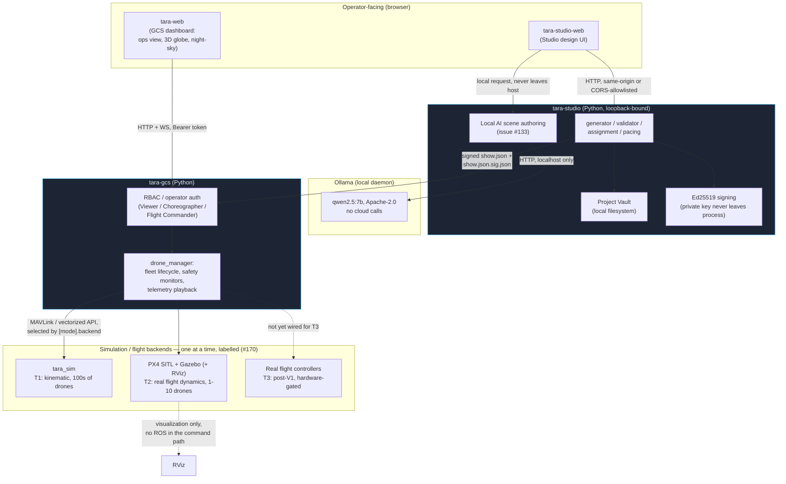

# Yukti / IIC Evidence Pack (issue #134)

Parent: [#122](https://github.com/harsh-pandhe/Taramandal-GCS/issues/122) (V1 Yukti/IIC integrated proof demonstrator).

This is the consolidated index #134 asks for: setup checklist, architecture
diagram, results matrix, and test evidence, in one place for review before
anything here is shared externally. It links out to the existing detailed
docs rather than duplicating them, and is explicit about what is still
missing — **this pack is not yet complete** (see [Status](#status) below).

Every tier label below follows the fidelity convention #170 established:

- **T1 (`tara_sim`)** — kinematic, no flight dynamics. Scales to hundreds of
  drones on one machine.
- **T2 (PX4 SITL + Gazebo, + RViz)** — real flight dynamics, 1–10 drones,
  bounded by what one machine's SITL instances can carry.
- **T3 (hardware)** — post-V1, only if safely approved and actually flown.

## Status

| Deliverable | State |
|---|---|
| Environment setup / run / test / recovery checklist | Done — links existing docs, below |
| Architecture diagram with trust/safety boundaries | Done, this document |
| Results matrix (T1 / T2 / T3) | Partially done — T1 filled, T2 partially filled (single-drone hover; the Diwali segment at 3 / 5 / 8 drones; #172's acceptance rerun after #220 open), T3 not started |
| Test evidence table (SHA, PR, fleet size, timing, separation) | Done for everything flown so far |
| Repeatable evidence checklist (commands that reproduce each result) | Done, [section 8](#8-repeatable-evidence-checklist); the human-gated items are listed there as blocked, not faked |
| Recordings (Studio full-screen preview, GCS + Gazebo + RViz) | **Not done** — Harsh's hardware/recording pass, see [#171](https://github.com/harsh-pandhe/Taramandal-GCS/issues/171) |
| Hardware BOM, wiring/configuration | **Not done** — owned by the hardware lead, not yet supplied |
| Asset/music provenance and usage rights | **Not done** — blocked on sourcing a licensed track, see [#132](https://github.com/harsh-pandhe/Taramandal-GCS/issues/132) |
| Limitations / next V2 steps | Done, below |
| Reviewed by Harsh before external sharing | **Not done** |

## 1. Environment setup, run, test and recovery checklist

Don't duplicate these — they're kept current as their own docs and are
exercised regularly, most recently while compiling this pack:

- **Clean setup and running the stack**: [README.md](../README.md)
  ("Quickstart"). `./tara doctor` first — it now checks Python/Node
  versions, not just that the binaries exist, and the PX4/Gazebo backend's
  own prerequisites (issue #177).
- **PX4 SITL + Gazebo backend specifically**: [sim/px4/README.md](../sim/px4/README.md)
  — pinned PX4 version, build recipe, known-good Gazebo version, and the
  Node-version crash mode `tara doctor` now catches before it takes the
  whole supervised stack down.
- **Signed show files** (Studio → GCS upload path): README.md,
  "Signed show files" section — `tara keygen` / `tara sign`, and the
  `--allow-unsigned` escape hatch for pre-signing development.
- **Running the full test suite, locally or via the exact CI gates**:
  [docs/local-ci.md](local-ci.md) — `./scripts/ci` runs the same 5 gates as
  the GitHub workflow (lint/typecheck, Python tests, frontend tests, scale
  regression, Playwright E2E/visual baseline), with the same pass/fail
  output either place.
- **Recovery**: the GCS persists its fleet/session state and resumes a
  killed-and-restarted process without losing in-flight show state —
  exercised directly by `packages/tara-gcs/tests/test_show_resume.py`,
  itself re-verified end-to-end as part of this pack's prep (see
  [issue #171's findings comment](https://github.com/harsh-pandhe/Taramandal-GCS/issues/171#issuecomment-6533695510)).

## 2. Architecture

**Trust/safety boundaries**, matching
[docs/security/studio_threat_model.md](security/studio_threat_model.md):

- **Studio binds to loopback by default.** CORS never allows a wildcard
  origin with credentials.
- **The Ed25519 signing private key never leaves the Studio process** —
  only the public key and fingerprint are ever served.
- **The GCS refuses an unsigned trajectory** (403) unless the stack was
  explicitly started with `--allow-unsigned` for local development.
- **Every GCS command endpoint requires an authenticated operator** since
  RBAC landed (#64) — `/api/status` is the one deliberate exception, kept
  unauthenticated for scripted health checks (`tara status`, this pack's
  own readiness probes).
- **RViz is visualization only** — it has no path back into the command
  chain; the GCS never depends on ROS being present or correct.
- **The local AI assistant (#133) is local-only**: Ollama runs on the same
  host, no network egress, and the model's own license (Apache-2.0) and
  digest (`qwen2.5:7b`, `sha256:845dbda0ea48…`, read from a local Ollama and
  matched against the registry on 2026-11-02) are recorded in
  [packages/tara-studio/README.md](../packages/tara-studio/README.md). The
  digest is documentation only; Studio does not check it at runtime.

## 3. Results matrix

| | T1 (`tara_sim`) | T2 (PX4 SITL + Gazebo) | T3 (hardware) |
|---|---|---|---|
| **Scale demonstrated** | 35 / 100 / 500 / 1000 drones | 1 drone (hover/climb/land cycle); 3 / 5 / 8 drones flying the real Diwali segment (#222, #220) | Not started |
| **What's proven** | Real-time factor ≥0.98 up to 1000 drones, zero late ticks, zero proximity/geofence/altitude violations across all 5 formation generators (circle, helix, heart, cube, spline). Studio-built shows now certify through the real `/api/export` jerk gate (#160, 5 reference shows). A 3-drone Studio-built show runs the whole software chain on the sim backend: signed export, GCS upload and staging, `preview_only` refusal, onboard refused before takeoff, streamed start reaches RUNNING (#172, T1 half). Sim-only fault tools exist for failsafe testing: distance-based + burst RF loss (#62) and RTK / battery / deviation / motor-failure injection (#63) | A full PREFLIGHT→ARM→climb-to-hover→dwell→land→disarm cycle against real PX4 flight-control code and Gazebo physics; the #145 climb-stall fix confirmed against real liftoff-ramp delay (observed 0.86 m vs 1.0 m target, within the `max(0.15, 0.1×target)` tolerance); a concurrent duplicate-hover request cleanly rejected without disturbing the original flight; pilot takeover mid-hover yielded to rather than fought (#211). A Studio-built show, the real Diwali 3-drone segment, flown through the GCS (signed, streamed start): 3 of 3 baseline runs pass, plus one run each at 5 and 8 drones (#222), and after the start-leg fix (#220) 3 of 3 pass with the start transient down from up to 3.7 s to 0.01 s and max tracking error from about 5.9 m to about 0.3 m | — |
| **What's outstanding** | — | The acceptance rerun of [#172](https://github.com/harsh-pandhe/Taramandal-GCS/issues/172) on `main` after #220 merged: the Diwali segment has been flown on PX4 SITL + Gazebo (before #220 at 3 / 5 / 8 drones, after it on the PR branch at 3), but #172 is not accepted from those runs; the human-witnessed Gazebo+RViz+GCS-dashboard recording and the remaining fault-matrix cases ([#171](https://github.com/harsh-pandhe/Taramandal-GCS/issues/171), owned by Harsh) | Safety approval, bench test, supervised hover/landing ([#135](https://github.com/harsh-pandhe/Taramandal-GCS/issues/135), explicitly deferred behind #171) |
| **Evidence** | [docs/fleet-scale-benchmark.md](fleet-scale-benchmark.md), [docs/validate-latency-benchmark.md](validate-latency-benchmark.md) | [Findings comment on #171](https://github.com/harsh-pandhe/Taramandal-GCS/issues/171#issuecomment-6533695510) | — |

The 35-drone near-term Dandiya show (NAVRATRI / diya / dandiya sticks /
HAPPY NAVRATRI) is confirmed T1 software/validation evidence per the
[comment on #134 itself](https://github.com/harsh-pandhe/Taramandal-GCS/issues/134#issuecomment-6397359332)
— minimum separation 2.000000 m at the shared launch pads (design limit
exactly, accepted as-is for this demo rather than widening the grid before
it), ≥2.05 m everywhere else. **This is a simulation/software validation
claim (`/api/validate`), not a physical flight claim.**

## 4. Test evidence

| Area | Evidence | SHA / PR | Fleet size | Result |
|---|---|---|---|---|
| Python test suite (all packages) | `pytest` | current `main` | — | 1517 tests collected, full suite (including `slow`-marked) passes |
| `/api/validate` latency | [docs/validate-latency-benchmark.md](validate-latency-benchmark.md) | #164, pinned by #189 (`bedd65f`) | 100 / 500 / 1000 | ~1.7 s / ~8 s / ~21 s via HTTP; near-linear growth, not the old superlinear blow-up |
| `tara_sim` real-time factor | [docs/fleet-scale-benchmark.md](fleet-scale-benchmark.md) | #51 | 100 / 500 / 1000 | xRT 1.00, 0.0% late ticks at every size tested |
| Formation generators, zero-violation | `packages/tara-studio/tests/test_generator_regression.py` | current `main` | 50 / 100 per shape × 5 shapes | 0 proximity / geofence / altitude violations |
| Circle-orbit pacing | `packages/tara-studio/tests/test_issue_88_circle_orbit_pacing.py` | #88, `d06a0fd` | 50 / 75 / 90 / 100 | Full 2π orbit completed (previously ~1/3 turn), 0 dynamics violations |
| Single-drone PX4 SITL + Gazebo hover cycle | [#171 findings comment](https://github.com/harsh-pandhe/Taramandal-GCS/issues/171#issuecomment-6533695510) | #201, `ee60b72` (groundwork); PX4 v1.16.2, Gazebo Sim 8.15 | 1 | 2 clean runs, climb to 0.86 m (target 1.0 m, within tolerance), clean land/disarm; 1 fault-matrix case (concurrent duplicate request) verified rejected |
| PX4 SITL world generation | #177, `fd05c9f` (generator) + `49117d3` (checkout fixes) | — | Confirmed loadable by a real Gazebo Sim 8.15 instance, real PX4 v1.16.2 spawn |
| GCS crash-recovery (kill + restart mid-show) | `packages/tara-gcs/tests/test_show_resume.py::test_kill_and_restart_gcs_process_recovers_state` | #201, `ee60b72` | 1 | Passes against a real spawned GCS process, RBAC-authenticated |
| Studio-web focus/motion accessibility | #132 (partial), #204, `420812d` | — | 54/54 Playwright e2e + visual-baseline tests pass, 0 snapshot diffs |
| Studio-built shows certify the jerk gate | `packages/tara-studio/tests/test_issue_160_jerk_pacing_certification.py` | #160, #179 `f8df46c` | 6 / 24 / 24 / 100 / 100 (5 reference shows) | 0 jerk violations through the real `/api/export`; shows plateau ~14-17 m/s³ against the 20 m/s³ limit; default build rate is now 10 Hz. Reference shows are reconstructions (the issue's exact scene parameters were not preserved) |
| Studio-built show through the GCS, sim backend (T1) | `packages/tara-gcs/tests/test_issue_172_studio_gcs_e2e.py` | #172 (software-chain half), #209 `3ee84a1` | 3 | Certified, Ed25519-signed export verified against GCS `trusted_keys`; upload and staging; `preview_only` refused; onboard refused before takeoff; streamed start reaches RUNNING. **Sim backend only; the PX4 SITL + Gazebo (T2) runs and recordings remain open** |
| RF channel model (sim) | `packages/tara-sim/tests/test_rf_channel.py`, `packages/tara-gcs/tests/test_sim_rf_channel.py` | #62, #206 `9497dde` | — | 100% loss for 5 s trips the offboard-loss failsafe to LAND; 10% loss flickers `connected` without latching; same seed gives a bit-identical sequence. TDMA slot jitter not implemented (split to #207) |
| Sensor / actuator fault injection (sim) | `packages/tara-gcs/tests/test_fault_injection.py`, `packages/tara-sim/tests/test_fleet_state.py` | #63, #208 `8870d4e` | 1 faulted drone per case | RTK loss, battery, 1.5 m position deviation (trips the real proximity monitor) and motor failure (drives the real abort-to-land path) each verified; 33 new tests. `backend=sim` only |
| Studio typography / visual-hierarchy pass | [PR #210](https://github.com/harsh-pandhe/Taramandal-GCS/pull/210) (part of #132) | #210 `b263a54` | — | Checked live in a real browser at 1440x900 and 1280x720; 13 visual baselines changed and each is justified in the PR; Docker Playwright 54/54 without `--update`; faint-text contrast raised from 2.9-3.4:1 to 4.6-5.4:1 |
| Pilot takeover & armed telemetry freshness (T2) | [PR #211](https://github.com/harsh-pandhe/Taramandal-GCS/pull/211) (part of #171) | #211 `1ac5de5` | 1 | Real PX4 SITL + Gazebo: GCS yields cleanly when pilot takes over mid-sequence (`OperatorTakeoverError`), preventing fighting flight commands; armed count in `/api/status` is heartbeat-fresh |
| Gazebo SITL spawn axis & pad alignment (T2) | [PR #215](https://github.com/harsh-pandhe/Taramandal-GCS/pull/215) (part of #172, F1) | #215 `2ae5b44` | 3 | Aligned Gazebo ENU world pads and spawn coordinates to GCS NED fleet frame (east axis); automatic reinstallation of world in `launch_fleet.sh`; 3 real SITL passes (2.00-2.04 m separation vs 2.05 m plan) |
| Planned vs actual Gazebo flight evaluation (T2) | [PR #213](https://github.com/harsh-pandhe/Taramandal-GCS/pull/213) (part of #172) | #213 `83d040d` | 3 (stretch to 10) | `tools/sitl_planned_vs_actual.py` tracking error evaluation tool and 11 SITL run records; clean flight up to 8 drones |
| Certified Diwali 2026 shows & scale runner | [PR #212](https://github.com/harsh-pandhe/Taramandal-GCS/pull/212) (part of #122) | #212 `8a243e9` | 3 / 35 / 100 / 500 | Storyboards and certified shows (0 violations); minimum separation >= 2.04 m across all fleet sizes; deterministic builds |
| High-rate incident recorder & crash resilience | [PR #214](https://github.com/harsh-pandhe/Taramandal-GCS/pull/214) (part of #65, V1) | #214 `bef8b7d` | 100 | `tara_gcs/blackbox.py` 10 Hz compressed JSONL log with differential quantization; 15 min 100 drones = 3.11 MB (< 25 MB budget); survives process kill |
| Show-scale real-time factor profiling | [PR #216](https://github.com/harsh-pandhe/Taramandal-GCS/pull/216) (part of #122) | #216 `92e99c6` | 35 / 100 / 500 | `tools/profile_show_rtf.py` and `docs/sim-rtf-profiling.md`; isolated state snapshot serialization cost (~32 of 34 s lost at 500 drones) |
| Mission-upload directory failure is loud (T2) | `packages/tara-gcs/tests/test_mission_upload_directory.py`; [PR #219](https://github.com/harsh-pandhe/Taramandal-GCS/pull/219) (part of #172, F2; builds on #217 `1d45275`) | #219 `2402008` | 3 | An uncreatable mission directory fails that drone's mission with the directory and the last error named, the other drone stays VERIFIED; existing directories unaffected. Real SITL, fresh container each run, no manual `mkdir`: all 3 drones took the mission in 6 runs; with `rootfs/0/fs` made a regular file the mission is FAILED and the launch gate stays closed. Simulated FTP gains `list_directory` |
| Streamed-start transition leg (T2) | `packages/tara-gcs/tests/test_start_bridge.py`, `test_streamed_start_transition.py`; [PR #220](https://github.com/harsh-pandhe/Taramandal-GCS/pull/220) and its [#172 comment](https://github.com/harsh-pandhe/Taramandal-GCS/issues/172#issuecomment-6576644381) (part of #172, F3) | #220 `0d20190` | 3 | Real Diwali 3-drone segment, 3 SITL runs: start transient 3.5-3.7 s → 0.01 s, max tracking error ~5.9 m → 0.286-0.306 m, Gazebo min separation 2.096-2.181 m (Studio plan 2.20), all PASS, no aborts. The leg is checked exactly against the 1.5 m monitor limit and an unsafe start is refused (400, stays in FORMATION_HOLD). Suite 1698 passed incl. slow. **`execution="onboard"` is untouched.** **The acceptance rerun on `main` after this merge is not recorded in this pack** |
| Baseline Diwali-segment acceptance, before #220 (T2) | [PR #222](https://github.com/harsh-pandhe/Taramandal-GCS/pull/222) (part of #172); `docs/sitl-planned-vs-actual.md` section D | #222 `aca621b`, flown on `7a6ab70` | 3 / 5 / 8 | 5 of 5 runs PASS (3 drones ×3, 5 ×1, 8 ×1): Gazebo min separation 2.106-2.169 m, RTF 0.913-1.000, no abort/RTL, worst landing error ≤ 0.083 m. **These runs include the start dive** (#220 was not merged), so they are the "before" for #220, not the final acceptance |
| Flight-mode hint on a failed arming gate (T2) | `packages/tara-gcs/tests/test_preflight_armable_detail.py`; [PR #223](https://github.com/harsh-pandhe/Taramandal-GCS/pull/223) (part of #171) | #223 `ba7f1af` | 1 | PX4 left in LAND/POSCTL read `Not armable` under "EKF health & home lock"; the detail now names the mode as a possible cause. Gate stays red, pass/fail logic unchanged. 4 new cases fail on the old code; full suite 1622 passed, 2 skipped. **Not re-flown on SITL** (text change in a pure function) |
| Single-drone hover with a loaded but unstarted show (T2) | `packages/tara-gcs/tests/test_hover_with_loaded_trajectory.py`; [PR #224](https://github.com/harsh-pandhe/Taramandal-GCS/pull/224) (part of #171) | #224 `9e6d2d4` | sim backend | The hover ran after any upload only until a GCS restart; now refused only unless every drone is confirmed parked (not armed, ON_GROUND from fresh telemetry), and the 409 names the drone and reason. 11 cases, 9 fail on the old code; full suite 1623 passed, 2 skipped. **Not re-flown on SITL at merge time.** Known sim-only side effect: a parked sim drone reads IN_AIR in ~0.6% of samples, so a hover is occasionally refused and a retry works (fails closed) |
| Diwali demo-day runbook and helpers | [docs/diwali-runbook.md](diwali-runbook.md); [PR #225](https://github.com/harsh-pandhe/Taramandal-GCS/pull/225) (part of #122) | #225 `bab839b`, commands run on `7a6ab70` | 3 / 35 / 100 / 500 | Docs and `tools/diwali_*` only. Anything not run is marked NOT VERIFIED in the runbook: the T2 helper `diwali_t2_sitl.sh` end to end, frame rate on a real GPU, any Gazebo/RViz window, T3. Finding: 100 drones cannot go through the GCS upload (5 MB / 100,000-row limit), so the 100-drone run uses `diwali_sim_scale.py` |
| Black-box recorder wired into the GCS | `packages/tara-gcs/tests/test_blackbox_wiring.py`; [PR #221](https://github.com/harsh-pandhe/Taramandal-GCS/pull/221) (part of #65; does not close it, the replay UI is out of scope) | #221 `b435358` | 100 (tick-cost test) | Default-on 10 Hz recording with commands, lifecycle transitions and breach flags pushed as they happen; 12 new tests including a real GCS startup/shutdown over HTTP. Measured with 100 drones running: no measurable change in event-loop lateness (0.85 → 0.75 ms), service poll mean 0.26 ms, p99 1.7 ms. Suite 1626 passed incl. slow |
| Shared export-gate predicate for the header badge and Transmit tab | `packages/tara-studio-web/src/engine/exportGate.test.js`, `SequencerHeader.test.jsx`; [PR #226](https://github.com/harsh-pandhe/Taramandal-GCS/pull/226) (part of #132, follow-up to #210) | #226 `60648b1` | — | The header badge and the Transmit buttons now use one `exportGate()`; a parity test fails if the badge says "exports enabled" while the JSON button is disabled (mutation-checked against the old rule: fails on exactly the three states from review). Checked live in Chromium at 1440×900: 4 states, badge and buttons agreed each time. 10 visual baselines changed, each measured. **"PASSED with no show built" is unit/parity-tested only; it cannot be reached in the live UI** |
| Figures-only Diwali fallback storyboards | `examples/diwali/storyboard_35_figures.json`, `storyboard_100_figures.json`; [PR #227](https://github.com/harsh-pandhe/Taramandal-GCS/pull/227) (part of #122) | #227 `b780f89` | 35 / 100 | Flight exports certified through `/api/export` with 0 violations across all categories (separation ≥ 2.05 m, ceiling 34.4 m / 62.8 m); flown in `tara_sim` with min separation 2.045 m and no proximity/geofence breach. Figures: diya, rangoli, sphere burst, diya finale |
| Stop-mid-rotation blackbox regression test | `packages/tara-gcs/tests/test_blackbox_wiring.py`, `test_blackbox.py`; [PR #229](https://github.com/harsh-pandhe/Taramandal-GCS/pull/229) (part of #65) | #229 `f9c6240` | 100 | Regression test `test_stop_cancelling_the_sampler_mid_rotation_still_finishes_the_old_file`: confirms canceling the sampler task during an in-flight rotation completes file close with valid gzip trailer (not truncated); 20 consecutive test runs passed under 16-core CPU load |

## 5. Hardware BOM, wiring and configuration

**Not supplied yet.** Owned by the hardware lead, not something this pack
can fill in from the software side. Placeholder section — fill in before
this pack is reviewed for external sharing.

## 6. Asset / music provenance and usage rights

**Not supplied yet.** The full-screen preview's music track (#132's scope)
needs a track with clear usage rights for a public/semi-public demo; no
track has been sourced. Placeholder section.

## 7. Limitations, uncompleted items and next V2 steps

- **No real multi-drone flight evidence yet, only simulated.** T2 is PX4
  SITL + Gazebo: a single drone's hover cycle (#171) and the real Diwali
  3-drone segment, with one run each at 5 and 8 drones (#222), which is a
  small fleet, not the 35 / 100 / 500 the T1 results cover. #172's acceptance
  rerun on `main` after #220 is still open, as is Harsh's own #171
  hardware/recording pass.
- **No real hardware evidence at all** — T3 is entirely future work,
  explicitly post-V1 per #135.
- **No recordings exist yet** for the pack's "Recordings" deliverable
  (Studio full-screen preview; GCS with Gazebo and RViz both visible).
  These require a human at the keyboard with a screen recorder, not
  something to simulate or fabricate.
- **#167** (widen the shared launch-pad grid from 2.0 m to 2.2 m) is
  implemented and merged (`8d5f209`) but kept open pending a maintainer
  decision on whether pre-#167 `.tara` files need a migration/version gate
  — noted here since it touches this pack's pad-spacing finding above.
- **V2 roadmap** (#123): the professional Studio/GCS workflow set — things
  like the full observability/replay tooling in #65, music-aware
  choreography in #91, and the broader AI copilot work in #89/#90/#94 — is
  explicitly out of this pack's scope; V1's evidence capture is
  deliberately the smaller slice #65's own roadmap note describes.

## 8. Repeatable evidence checklist

Run from the repo root with the venv active (`source .venv/bin/activate`) and
`export PYTEST_DISABLE_PLUGIN_AUTOLOAD=1` (what `scripts/ci-gates/lib.sh`
sets; it keeps ROS's pytest plugins out). "Re-run" means the command was run
again, as written here, on 2026-11-01 (Ubuntu, Python 3.12) while writing this
section. Anything not marked re-run is documented but was not re-run then.

### A. Software evidence, no special hardware (T1)

| # | Claim in this pack | Command | Expect | Re-run |
|---|---|---|---|---|
| A1 | Environment is sane | `./tara doctor` | Every check green; a red line names its own fix | no (needs PX4 build for the px4 checks) |
| A2 | Studio shows certify the jerk gate through the real `/api/export` (#160) | `pytest -p asyncio -q packages/tara-studio/tests/test_issue_160_jerk_pacing_certification.py` | all 5 reference shows pass | yes |
| A3 | 5 formation generators, zero proximity/geofence/altitude violations | `pytest -p asyncio -q packages/tara-studio/tests/test_generator_regression.py` | pass | yes |
| A4 | Circle orbit completes a full turn at N=50-100 (#88) | `pytest -p asyncio -q packages/tara-studio/tests/test_issue_88_circle_orbit_pacing.py` | pass | yes |
| A5 | `validate_show` stays near-linear at 500 drones (#164) | `pytest -p asyncio -q packages/tara-core/tests/test_validate_scale.py` | pass (a CI regression guard, not a timing table) | yes |
| A6 | Studio-built show through the GCS on the sim backend (#172, T1 half) | `pytest -p asyncio -q packages/tara-gcs/tests/test_issue_172_studio_gcs_e2e.py` | pass | yes |
| A7 | RF channel model (#62) | `pytest -p asyncio -q packages/tara-sim/tests/test_rf_channel.py packages/tara-gcs/tests/test_sim_rf_channel.py` | pass | yes |
| A8 | Fault injection (#63) | `pytest -p asyncio -q packages/tara-gcs/tests/test_fault_injection.py` | pass | yes |
| A9 | 100-drone sim show, zero safety violations (CI's scale gate) | `./scripts/ci --job scale-regression`, or `pytest -p asyncio -v packages/tara-gcs/tests/test_sim_backend.py::test_100_drone_sim_show_completes_with_zero_safety_violations` | pass; takes ~1.5 min by design (launch stagger) | yes (pytest form) |
| A10 | GCS recovers from kill + restart mid-show | `pytest -p asyncio -q packages/tara-gcs/tests/test_show_resume.py` | pass; marked `slow`, so CI skips it | yes |
| A11 | Real-time factor and late ticks vs fleet size | `python tools/benchmark_fleet_scale.py -n 100,500,1000` | xRT about 1.00, 0.0% late ticks at each size; writes `tools/benchmark_results.json` (gitignored) | `-n 100` only: xRT 1.00, 0.0% late |
| A12 | Full Python suite, including `slow` | `pytest -p asyncio` (CI's gate is `pytest -p asyncio -m "not slow"`, i.e. `./scripts/ci --job python-tests`) | no failures | no |

A2-A8 ran together as one command: 88 passed in about 35 s. A9 and
A10 together: 10 passed in about 104 s.

### B. Studio web (the #132 evidence)

| # | Claim | Command | Expect | Re-run |
|---|---|---|---|---|
| B1 | Unit tests | `cd packages/tara-studio-web && npm ci && npm test` | all pass (573 tests, 36 files) | yes, on `main` `b435358`, 2026-11-02 |
| B2 | Lint and production build | `npm run lint && npm run build` | clean | yes, on `main` `b435358` |
| B3 | Visual baselines unchanged | `npm run test:e2e:docker` (Docker required; do not run Playwright natively, its fonts differ from CI) | 54 passed (took about 10.7 min) | yes, on `main` `b435358`, without `--update` |
| B4 | A visual change is intentional | `npm run test:e2e:docker:update`, then review every changed PNG in `e2e/studio.spec.js-snapshots/`, then re-run B3 without `--update` | B3 passes; each changed image is justified in the PR | done for #210 (13 images) and #226 (10 images) |
| B5 | The CI gates as CI runs them | `./scripts/ci` (or `--job lint-and-typecheck`, `frontend-tests`, `test-e2e`; `--list` prints the names) | all gates pass | no |

B1-B3 were re-run on `main` at `b435358`, which contains #210 and #226. A
later change to Studio web needs them re-run again.

### C. T2: PX4 SITL + Gazebo (needs the PX4 build)

Prerequisites are in [sim/px4/README.md](../sim/px4/README.md): pinned PX4
v1.16.2, Gazebo Sim 8, and the generated world
(`PYTHONPATH=packages/tara-core python3 sim/px4/generate_world.py`).

| # | Claim | Command | Expect | Re-run |
|---|---|---|---|---|
| C1 | The PX4 stack comes up | `./tara doctor`, then `./tara up --backend px4 -n 1 --allow-unsigned` | doctor all green; GCS, Studio and both web servers answer | no (done once, in the #171 findings comment) |
| C2 | Single-drone hover cycle (#145) | With the stack up and a Commander-role operator: `POST $GCS_URL/api/auth/login` with `{"operator": ..., "passphrase": ...}`, then `POST $GCS_URL/api/single-drone/hover-sequence` with `Authorization: Bearer <token>` and `{"target_altitude_m": 1.0, "hover_duration_s": 5.0}` | PREFLIGHT, ARM, climb to within the `max(0.15, 0.1 x target)` tolerance (0.86 m observed), hold, land, disarm | no (done twice in the #171 comment) |
| C3 | Duplicate hover request is rejected | Send C2's second request while the first is climbing | HTTP error "A single-drone sequence is already running on drone 0."; the first flight is unaffected | no (done once) |

`GCS_URL` is the gcs-api address `tara up` prints. The throwaway-operator and
login setup is demonstrated in `packages/tara-gcs/tests/test_show_resume.py`.

### D. Known gaps in reproducibility (not hidden)

- **`/api/validate` latency table** (about 1.7 s / 8 s / 21 s at 100 / 500 /
  1000): measured with a throwaway script that was not committed. A5 guards
  the 500-drone direct call but does not reproduce the HTTP figures. Either
  commit the script or treat the table as a one-time measurement.
- **35-drone Dandiya "min separation 2.000000 m" claim** (section 3): its
  source is a comment on #134; no committed command regenerates it.
- **Exact original reference-show parameters for #160** were not preserved;
  A2 runs reconstructions.
- **Other fault-matrix cases**: Pilot stick takeover, heartbeat loss mid-hover,
  and duplicate concurrent requests were exercised against real PX4 v1.16.2 SITL
  in #211 (finding table on #171). The RViz/Gazebo multi-window screen recording
  remains the human-gated piece owned by Harsh.

### E. Blocked: cannot be done from the sandbox

| Item | Blocked on | Why |
|---|---|---|
| #132 walkthrough recording (Studio create, build, validate, full-screen preview, export, no terminal) | a human with a screen recorder | The pack must not contain a simulated recording. Repeatable once someone does it: start `./tara up --backend sim -n 20`, open Studio, follow the walkthrough in #132's acceptance list, and record at 1440x900. The Studio steps, including the header safety states a recording should show (`Safety passed · exports enabled` and the locked states from #226), are in [docs/diwali-runbook.md section 2.4](diwali-runbook.md#24-studio-full-screen-preview-35-and-100-drones) |
| Gazebo + RViz + GCS dashboard recording (#171) | Harsh (owns the run); RViz and a display are not available here | Acceptance needs all three visible simultaneously |
| Music track and usage rights (#132) | Harsh to approve a licensed source | No track has been chosen; do not add one without recorded rights |
| Hardware (T3), BOM, wiring (#135) | Safety approval; hardware lead; Harsh's PX4-vs-ArduCopter answer | Nothing exists to run |

---

🤖 Generated with [Claude Code](https://claude.com/claude-code)
