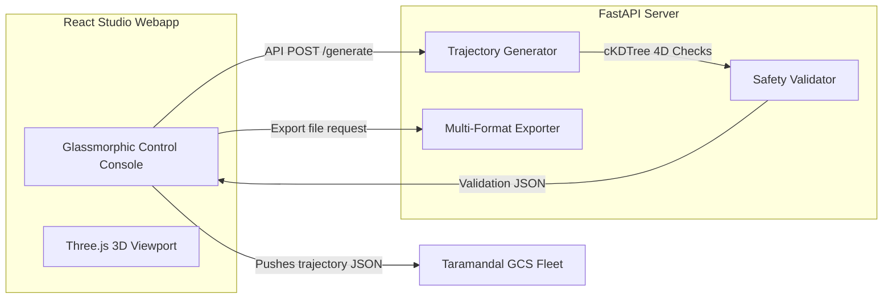

# 🛸 Taramandal Studio: Swarm Choreography Engine

Taramandal Studio is an industry-grade swarm choreography generator and 3D visualizer. It provides drone show designers with parametric tools to generate, preview, safety-validate, and export complex multi-vehicle flight trajectories.

---

## 🎨 System Overview



---

## 📐 Parametric Shape Math Specifications

The Studio engine generates time-ordered waypoints $(t, x, y, z, \psi)$ at a configured sample rate ($R$ Hz). Drones launch from spacing-aligned pads on the ground, climb to separate target hover altitudes, execute the shape, and land back on their home pads.

### 1. Rotating Circle
Drones are spaced out evenly along the perimeter of a circle:
$$\theta_i(t) = \frac{2\pi \cdot i}{N} + \frac{2\pi \cdot t}{T_{\text{choreo}}}$$
$$x_i(t) = X_c + r \cdot \cos(\theta_i(t))$$
$$y_i(t) = Y_c + r \cdot \sin(\theta_i(t))$$
$$z_i(t) = -Z_{i,\text{hover}}$$
where $N$ is the number of drones, $T_{\text{choreo}}$ is the circular choreography period, and $(X_c, Y_c)$ is the arena center.

### 2. 3D Helix (Spiral)
Combines circular rotation with height oscillation:
$$z_i(t) = -\left(Z_{i,\text{hover}} + A_{\text{osc}} \cdot \sin\left(\frac{2\pi \cdot t}{T_{\text{osc}}} + i\right)\right)$$
Adding vertical sinusoidal oscillation creates a shifting double-helix swarm pattern.

### 3. Spinning Heart
Follows the classic 2D parametric cardiod:
$$hx(\theta) = 16 \cdot \sin^3(\theta)$$
$$hy(\theta) = 13 \cdot \cos(\theta) - 5 \cdot \cos(2\theta) - 2 \cdot \cos(3\theta) - \cos(4\theta)$$
Drones map to the cardiod perimeter and rotate around the Z-axis dynamically.

---

## 🚨 Pre-flight 4D Safety Validation

Before any trajectory is cleared for push/export, the choreography is evaluated step-by-step ($\Delta t = 0.1$s) against strict flight safety constraints using high-performance spatial partitioning (`scipy.spatial.cKDTree`):

1. **Proximity Checks**: Ensures no two drones drift within the safety threshold ($d < 0.8$m).
2. **Velocity Checks**: Compares consecutive waypoints to verify speed remains within limits ($v \le 6.0$ m/s).
3. **Acceleration Checks**: Monitors acceleration changes ($a \le 50.0$ m/s²).
4. **Yaw Rate Checks**: Validates yaw spin limits ($\dot{\psi} \le 300.0$ deg/s).

---

## ⚙️ How to Run

### Setup Virtual Environment
```bash
python3 -m venv .venv
source .venv/bin/activate
pip install -r requirements.txt
```

### Start Backend Engine (Port 8001)
```bash
PYTHONPATH=. python studio/server.py
```
*Configurable via `STUDIO_HOST` and `STUDIO_PORT` environment variables.*

### Start Visualizer UI (Port 5174)
```bash
cd frontend
npm install
npm run dev -- --host 0.0.0.0 --port 5174
```

---

## 🗄️ Project Vault

Projects are stored by the backend, not by the browser (issue #101), so a show saved from one browser opens in another and survives a cleared cache. Each project is a directory of plain JSON files:

```
<vault>/<project id>/project.json   name, revision, scenes + fleet, save history, validation report
<vault>/<project id>/show.json      the built trajectory, a show_v1 file (schemas/show_v1.json)
<vault>/.trash/                     deleted projects, kept for recovery
```

The vault is `~/.local/share/taramandal/projects` unless `STUDIO_VAULT_DIR` or `[studio].vault_dir` in `tara.toml` says otherwise. Back it up by copying the directory.

| Endpoint | Purpose |
|---|---|
| `GET /api/projects` | List projects (without their built show) |
| `POST /api/projects` | Create |
| `GET /api/projects/{id}` | One project with its built show |
| `PUT /api/projects/{id}` | Save; needs `base_revision`, answers `409 revision_conflict` to a stale save |
| `DELETE /api/projects/{id}` | Move to `.trash` |
| `POST /api/projects/import` | Import a project from a browser's old localStorage vault; safe to repeat |

One writer at a time: a save based on an out-of-date revision is refused, and the web app then stores those edits as a separate "(conflicted copy)" project instead of overwriting. Projects a browser saved before the vault existed are imported the first time it connects; the old localStorage entry is left in place.

The vault API has no authentication, like the rest of the Studio backend. Keep `STUDIO_HOST` on a trusted network if you point several machines at one backend.

---

## 🎬 Blender Trajectory Exporter

For animations custom-designed in **Blender**, `studio/blender_export.py` can be run inside Blender's python runtime (`bpy`) to scrape keyframes:
```bash
blender --background my_show_scene.blend --python studio/blender_export.py -- my_trajectory.json
```
Ensure your Blender objects are named `Drone_00`, `Drone_01`, etc. The script automatically translates Blender coordinates (positive-Z up) to PX4 local NED coordinates (negative-Z up).

---

## 🤖 AI Scene Authoring (V1 narrow assistant, issue #133)

`POST /api/ai/propose` (`tara_studio.ai_author`) turns one prompt plus an
optional uploaded SVG into a single typed scene draft — a closed-enum
"shape token," placement, colour and duration — which the operator must
explicitly Apply or Discard; the model never touches geometry validation,
safety limits, export signing or GCS/flight control. See the module
docstring in `ai_author.py` for the schema/repair design.

- **Model**: [`qwen2.5:7b`](https://huggingface.co/Qwen/Qwen2.5-7B-Instruct)
  served locally via [Ollama](https://ollama.com) (`OLLAMA_MODEL` env var to
  override the tag). This is the S0 baseline measured in the issue — no
  further models were benchmarked for V1.
- **Pinned digest** (a tag can be repointed upstream, so the tag alone does
  not identify the weights): `qwen2.5:7b` is Ollama model ID `845dbda0ea48`,
  full digest
  `sha256:845dbda0ea48ed749caafd9e6037047aa19acfcfd82e704d7ca97d631a0b697e`
  (7.6B parameters, Q4_K_M). This is the digest of the copy in the
  development machine's Ollama, pulled 2026-10-12, read with
  `curl -s localhost:11434/api/tags` (the `digest` field; `ollama list`
  shows its first 12 characters as `ID`). On 2026-11-02 it also matched the
  registry: `curl -s -H "Accept: application/vnd.docker.distribution.manifest.v2+json"
  https://registry.ollama.ai/v2/library/qwen2.5/manifests/7b | sha256sum`
  printed the same value. The digest is recorded here, not enforced: nothing
  in Studio checks it at runtime. If you pull the model again, re-run the
  `/api/tags` command and update this line if the digest differs.
- **License**: Apache License 2.0 (per the
  [official model card](https://huggingface.co/Qwen/Qwen2.5-7B-Instruct)),
  permits commercial use; keep the license/copyright notice if you
  redistribute weights.
- **Runtime dependency**: a local Ollama install/daemon. No cloud API calls,
  no network egress for inference. If Ollama isn't running or the model
  isn't pulled, `propose()` reports `"unavailable"` and the rest of Studio's
  manual authoring workflow is unaffected.

### Scene-edit planner (issue #94)

`POST /api/ai/plan` (`tara_studio.ai_plan`) turns one sentence plus a compact
summary of the current scenes into at most 3 ops: a `patch` of an existing
scene, an `add`, or one of `move`, `delete`, `duplicate`. Scenes are referred
to by their 1-based number, never an id. It uses the same local `qwen2.5:7b` (Ollama, schema-constrained
output) and the same env vars as `/api/ai/propose`; it is local-only, with no
cloud call.

- **Draft only.** The browser compiles the ops into one `scene/batch` and the
  Studio's existing proposal flow (preview, dry-run safety check, explicit
  Apply, one undo step) decides whether anything changes. The model never
  sees ids and cannot reach safety limits, fleet, GCS or flight commands;
  requests for those, for show length, music or colour go in `unsupported`.
- **One repair in total.** The backend makes exactly one model call per
  request and never retries internally. If the browser's own check refuses
  the draft, it calls once more with `repair_note` set to the exact reason,
  then stops and shows that reason: at most 2 model calls per user request.
- **Refuse, never clamp.** Out-of-range values (scale above 3, hold above 120,
  ...) are passed through unchanged and refused by the browser's batch check.
  This differs from `/api/ai/propose`, which clamps.
- Always HTTP 200 with a `status` (`ok`, `schema_error`, `unavailable`,
  `timeout`); only a malformed request body is a 422. Tests fake the model
  (`tests/test_ai_plan*.py`); none need a live Ollama.
- **Two deterministic guards** (the 7B model ignored the prompt rules for both):
  - *Show length.* A request to change the total show length or duration
    ("make the show 2 minutes long") that names no scene is answered with no
    ops and "not supported", before any model call. Spelled-out numbers count
    ("two minutes"). A sentence naming a scene ("set hold of scene 1 to 90
    seconds") is an ordinary edit, and so is one about the whole show that is not
    about its length ("make the whole show bigger").
  - *Scene name on add.* If the model leaves out the name of an added scene
    but the operator wrote `scene called`/`named`/`titled` followed by a quoted or
    plain name, that name is used (not "the one called Opening", which names an
    existing scene) (first nameless add only; never over a name
    the model gave; a name over 60 characters is left unset, not truncated).
- **Moving, deleting and duplicating scenes.** The ops are
  `{"op":"move","scene":N,"position":"before"|"after","target":M}` or
  `{"op":"move","scene":N,"position":"first"|"last"}` (no target),
  `{"op":"delete","scene":N}` and `{"op":"duplicate","scene":N}`; they carry no
  other fields. Rules, enforced in code and not left to the model:
  - A `move` must be the only op in a draft, and a draft has at most one
    `delete` (both are a `schema_error`, so the one repair may fix them).
  - `delete` and `move` need their scene number (and a move's target) written
    as a scene reference in the operator's sentence ("scene 2", "Scene2", "scenes 2", "#2", "scene #2";
    a bare number such as "hold 3 seconds" or "after 3" does not count, and the 12
    in "scene 12" is not a 2). The number must also belong to its verb: the scene
    deleted follows delete/remove/drop/get rid of, the scene moved follows
    move/put/send/shift/relocate/reorder, and a move's target follows
    before/after. (A real draft for "move scene 1 after scene 3 and make scene 2 a
    heart" moved scene 2: the 2 was written, but for the heart.) Otherwise the
    answer is final, with no ops and no repair: "deleting a scene needs a scene
    number, e.g. 'delete scene 2'". So "remove the boring scenes" and "delete the
    last scene" are refused, never guessed. `duplicate` does not need this.
  - One rewrite, and only this one: the model turns "move scene 2 to the end" into
    "after scene 3", a target nobody wrote. When the sentence says end/last/back/
    bottom (or start/first/beginning/top/front) and the target is just that edge
    scene, it is changed to `last`/`first`. A target the operator did write is
    never rewritten.
  - A scene number or target above the show's scene count is the same final
    "does not exist" answer as for a patch. Scene 0 or below (the model
    mislabelling the op) and a move target equal to its own scene are a
    `schema_error`, so the one repair may fix them.
  - In the browser every op is compiled by scene id into one `scene/batch`
    (`engine/planCompile.js`, with one shared move helper in
    `engine/sceneOrder.js` that the typed grammar also uses). The last scene is
    never deleted, a scene deleted earlier in the draft cannot be touched again,
    and a move to the place a scene already has is refused, each with a clear
    message and no repair call.
- **Checking against the real model.** `python tools/plan_smoke.py [sentences.txt]`
  (optional `--scenes scenes.json`) runs sentences through `plan()` against a
  local Ollama with `qwen2.5:7b` and prints status, ops, unsupported, error and
  time for each. It needs Ollama running; pytest never runs it against a model.
  It makes one call per sentence; the app sends a draft that fails the schema
  check back once, so a `schema_error` there is not always what an operator sees.
  Use it before merging any change to the planner's prompt, schema or ops.
